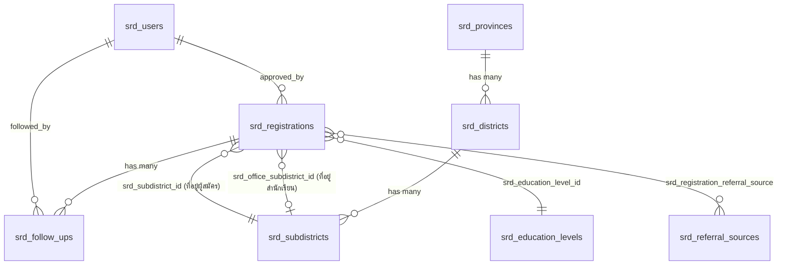

# โมดูลสมัครสอบธรรมศึกษา (Exam Registration Module) — Laravel + MySQL Spec

> เอกสารนี้แปลง workflow และกฎทางธุรกิจทั้งหมดจากระบบเดิม (Next.js + Google Sheets, ดูเอกสาร `docs/ux-ui/*.md`)
> เป็นสเปกสำหรับสร้างใหม่ด้วย **Laravel + MySQL** ชื่อตารางทุกตาราง **ขึ้นต้นด้วย `srd_` เสมอ**
> ใช้เป็นแบบสำหรับทีมพัฒนาสร้าง migration / model / controller / request จริง

**Stack:** Laravel 11.x, PHP 8.2+, MySQL 8.x, (แนะนำ) Laravel Breeze/Jetstream สำหรับ auth scaffold, Livewire หรือ Alpine.js สำหรับฟอร์ม multi-step ฝั่ง public

---

## 1. ภาพรวมโมดูล

| ส่วน | รายละเอียด |
|---|---|
| ชื่อโมดูล | `ExamRegistration` (สมัครสอบธรรมศึกษา) |
| Namespace แนะนำ | `App\Modules\ExamRegistration\*` หรือ `App\Http\Controllers\ExamRegistration\*` ถ้าไม่แยกโมดูล |
| ฝั่งผู้ใช้ | (1) Public — กรอกใบสมัคร ไม่ต้อง login (2) Dashboard — เจ้าหน้าที่ 5 ระดับสิทธิ์ |
| Prefix ตารางฐานข้อมูล | `srd_` **ทุกตาราง** |
| Prefix route (แนะนำ) | public: `/` และ `/exam-registration/*`, dashboard: `/dashboard/*` |

---

## 2. ตารางฐานข้อมูล (Database Schema)

### สรุปตารางทั้งหมด

| ตาราง | หน้าที่ | เทียบกับระบบเดิม |
|---|---|---|
| `srd_users` | ผู้ใช้งานเจ้าหน้าที่ + role | hardcoded `users[]` ใน `auth.ts` |
| `srd_registrations` | ใบสมัครสอบธรรมศึกษา | ชีต `Registrations` (37 คอลัมน์) |
| `srd_follow_ups` | ประวัติการติดตามผู้สมัคร | ชีต `FollowUps` |
| `srd_settings` | ค่าตั้งค่าระบบ (key-value) | ชีต `Settings` |
| `srd_provinces` | จังหวัด | `thai-addresses.json` |
| `srd_districts` | อำเภอ/เขต | `thai-addresses.json` |
| `srd_subdistricts` | ตำบล/แขวง + รหัสไปรษณีย์ | `thai-addresses.json` |
| `srd_referral_sources` | master ช่องทางที่รู้จัก (option list) | hardcode array `referralSources` |
| `srd_registration_referral_source` | pivot: ใบสมัคร ↔ ช่องทางที่รู้จัก (many-to-many) | ฟิลด์ string คั่น `, ` ในชีตเดิม |
| `srd_education_levels` | master ระดับการศึกษา (option list) | hardcode array `educationLevels` |

> หมายเหตุ: ระบบเดิมเก็บที่อยู่ไทยเป็น JSON แบบ flat record (province/district/subdistrict/postalCode) ในไฟล์เดียว เพื่อให้ relational และ query เร็วขึ้นบน MySQL จึง **แยกเป็น 3 ตาราง normalized** (`srd_provinces` → `srd_districts` → `srd_subdistricts`) พร้อม foreign key แทนการ filter JSON ฝั่ง client

### 2.1 `srd_users`

| Column | Type | Constraint | หมายเหตุ |
|---|---|---|---|
| `id` | `BIGINT UNSIGNED` | PK, auto_increment | |
| `username` | `VARCHAR(50)` | UNIQUE, NOT NULL | ใช้ login |
| `password` | `VARCHAR(255)` | NOT NULL | **ต้อง hash ด้วย bcrypt/argon2** (ของเดิม plaintext — ต้องแก้) |
| `display_name` | `VARCHAR(150)` | NOT NULL | ชื่อแสดงผล เช่น "ผู้ดูแลระบบ" |
| `role` | `ENUM('superadmin','admin','teacher','student','guest')` | NOT NULL DEFAULT `'guest'` | |
| `is_active` | `BOOLEAN` | NOT NULL DEFAULT `1` | เผื่อปิดบัญชี (ของเดิมไม่มี) |
| `remember_token` | `VARCHAR(100)` | NULLABLE | มาตรฐาน Laravel auth |
| `created_at`, `updated_at` | `TIMESTAMP` | NULLABLE | |

```php
Schema::create('srd_users', function (Blueprint $table) {
    $table->id();
    $table->string('username', 50)->unique();
    $table->string('password');
    $table->string('display_name', 150);
    $table->enum('role', ['superadmin', 'admin', 'teacher', 'student', 'guest'])->default('guest');
    $table->boolean('is_active')->default(true);
    $table->rememberToken();
    $table->timestamps();
});
```

### 2.2 `srd_provinces` / `srd_districts` / `srd_subdistricts`

```php
Schema::create('srd_provinces', function (Blueprint $table) {
    $table->id();
    $table->string('name_th', 100)->unique();
    $table->timestamps();
});

Schema::create('srd_districts', function (Blueprint $table) {
    $table->id();
    $table->foreignId('srd_province_id')->constrained('srd_provinces')->cascadeOnDelete();
    $table->string('name_th', 100);
    $table->timestamps();
    $table->unique(['srd_province_id', 'name_th']);
});

Schema::create('srd_subdistricts', function (Blueprint $table) {
    $table->id();
    $table->foreignId('srd_district_id')->constrained('srd_districts')->cascadeOnDelete();
    $table->string('name_th', 100);
    $table->string('postal_code', 5);
    $table->timestamps();
    $table->index(['srd_district_id', 'name_th']);
});
```

> ตำบลหนึ่งอาจมีหลายรหัสไปรษณีย์ได้ (เหมือนของเดิม) — ไม่ unique บน `name_th` เดี่ยวๆ ใช้ index ร่วมแทน

### 2.3 `srd_education_levels` (master, option list แทนที่ enum เพื่อแก้ไขได้โดยไม่ deploy ใหม่)

```php
Schema::create('srd_education_levels', function (Blueprint $table) {
    $table->id();
    $table->string('name_th', 50)->unique(); // ป.๔, ป.๕, ..., ม.๖, ปริญญาตรี, ประชาชนทั่วไป
    $table->unsignedSmallInteger('sort_order')->default(0);
    $table->timestamps();
});
```

### 2.4 `srd_referral_sources` (master)

```php
Schema::create('srd_referral_sources', function (Blueprint $table) {
    $table->id();
    $table->string('name_th', 100)->unique(); // เว็บไซต์, เพจวัดสารอด, เพื่อนแนะนำ, ..., อื่นๆ
    $table->boolean('allow_custom_text')->default(false); // true เฉพาะแถว "อื่นๆ"
    $table->unsignedSmallInteger('sort_order')->default(0);
    $table->timestamps();
});
```

### 2.5 `srd_registrations` (ตารางหลัก — เทียบเท่าชีต Registrations)

| Column | Type | Constraint | เทียบฟิลด์เดิม |
|---|---|---|---|
| `id` | `BIGINT UNSIGNED` | PK | |
| `registration_code` | `VARCHAR(30)` | UNIQUE, NOT NULL | `REG-YYYYMMDD-XXXXXXXX` (registrationId) |
| `academic_year` | `SMALLINT UNSIGNED` | NOT NULL | ปีการศึกษา พ.ศ. |
| `title` | `VARCHAR(20)` | NOT NULL | คำนำหน้าชื่อ |
| `first_name` | `VARCHAR(150)` | NOT NULL | |
| `last_name` | `VARCHAR(150)` | NOT NULL | |
| `age` | `TINYINT UNSIGNED` | NOT NULL | 1–120 (เช็คที่ application + DB CHECK) |
| `dob_day` | `TINYINT UNSIGNED` | NOT NULL | |
| `dob_month` | `VARCHAR(20)` | NOT NULL | ชื่อเดือนไทย (หรือเปลี่ยนเป็น TINYINT 1-12 แนะนำ) |
| `dob_year_be` | `SMALLINT UNSIGNED` | NOT NULL | ปีเกิด พ.ศ. |
| `citizen_id` | `CHAR(13)` | UNIQUE, NOT NULL | เลขบัตรประชาชน (ใช้กันสมัครซ้ำ — DB-level unique ด้วย ไม่ใช่แค่ query) |
| `address_no` | `VARCHAR(50)` | NOT NULL | บ้านเลขที่ |
| `moo` | `VARCHAR(20)` | NULLABLE | หมู่ที่ |
| `srd_subdistrict_id` | `BIGINT UNSIGNED` | FK → `srd_subdistricts.id`, NOT NULL | ที่อยู่ผู้สมัคร |
| `postal_code` | `CHAR(5)` | NOT NULL | (denormalized เก็บซ้ำเพื่อ query เร็ว, ต้องตรงกับ subdistrict) |
| `srd_education_level_id` | `BIGINT UNSIGNED` | FK → `srd_education_levels.id`, NOT NULL | การศึกษาปัจจุบัน |
| `has_previous_cert` | `BOOLEAN` | NOT NULL DEFAULT `0` | เคยสอบได้มาก่อนหรือไม่ |
| `prev_cert_no` | `VARCHAR(50)` | NULLABLE | เลขทะเบียนประกาศนียบัตรเดิม |
| `prev_level` | `ENUM('ตรี','โท')` | NULLABLE | ชั้นเดิมที่สอบได้ |
| `prev_range` | `ENUM('ประถมศึกษา','มัธยมศึกษา','อุดมศึกษา')` | NULLABLE | ช่วงชั้นเดิม |
| `prev_passed_year_be` | `SMALLINT UNSIGNED` | NULLABLE | ปีที่สอบได้ (พ.ศ.) |
| `prev_province` | `VARCHAR(100)` | NULLABLE | จังหวัดที่สอบได้เดิม (free text ของเดิม) |
| `target_level` | `ENUM('ตรี','โท','เอก')` | NOT NULL | ชั้นที่สมัครสอบ |
| `target_range` | `ENUM('ประถมศึกษา','มัธยมศึกษา','อุดมศึกษา')` | NOT NULL | ระดับช่วงชั้นที่สมัคร |
| `office_name` | `VARCHAR(200)` | NOT NULL | สำนักเรียน/สถานศึกษา |
| `srd_office_subdistrict_id` | `BIGINT UNSIGNED` | FK → `srd_subdistricts.id`, NULLABLE | ที่อยู่สำนักเรียน (NULL = ใช้ตามที่อยู่ผู้สมัคร) |
| `office_postal_code` | `CHAR(5)` | NULLABLE | |
| `status` | `ENUM('PENDING','APPROVED','REJECTED')` | NOT NULL DEFAULT `'PENDING'` | สถานะการสมัคร |
| `approved_by` | `BIGINT UNSIGNED` | FK → `srd_users.id`, NULLABLE | ผู้อนุมัติ/ปฏิเสธ |
| `approved_at` | `TIMESTAMP` | NULLABLE | วันที่อนุมัติ |
| `submitted_at` | `TIMESTAMP` | NOT NULL | วันที่ยื่นสมัคร (= created_at ก็ได้) |
| `follow_up_status` | `ENUM('','FOLLOW_PENDING','FOLLOW_IN_PROGRESS','FOLLOW_SUCCESS','FOLLOW_CANCELLED')` | NOT NULL DEFAULT `''` | สถานะการติดตาม |
| `phone` | `VARCHAR(15)` | NOT NULL | เบอร์โทรศัพท์ |
| `line_id` | `VARCHAR(50)` | NULLABLE | ไอดีไลน์ |
| `referral_other` | `VARCHAR(255)` | NULLABLE | ข้อความ "อื่นๆ" ของช่องทางที่รู้จัก |
| `created_at`, `updated_at` | `TIMESTAMP` | | |

```php
Schema::create('srd_registrations', function (Blueprint $table) {
    $table->id();
    $table->string('registration_code', 30)->unique();
    $table->unsignedSmallInteger('academic_year');
    $table->string('title', 20);
    $table->string('first_name', 150);
    $table->string('last_name', 150);
    $table->unsignedTinyInteger('age');
    $table->unsignedTinyInteger('dob_day');
    $table->string('dob_month', 20);
    $table->unsignedSmallInteger('dob_year_be');
    $table->char('citizen_id', 13)->unique();
    $table->string('address_no', 50);
    $table->string('moo', 20)->nullable();
    $table->foreignId('srd_subdistrict_id')->constrained('srd_subdistricts');
    $table->char('postal_code', 5);
    $table->foreignId('srd_education_level_id')->constrained('srd_education_levels');
    $table->boolean('has_previous_cert')->default(false);
    $table->string('prev_cert_no', 50)->nullable();
    $table->enum('prev_level', ['ตรี', 'โท'])->nullable();
    $table->enum('prev_range', ['ประถมศึกษา', 'มัธยมศึกษา', 'อุดมศึกษา'])->nullable();
    $table->unsignedSmallInteger('prev_passed_year_be')->nullable();
    $table->string('prev_province', 100)->nullable();
    $table->enum('target_level', ['ตรี', 'โท', 'เอก']);
    $table->enum('target_range', ['ประถมศึกษา', 'มัธยมศึกษา', 'อุดมศึกษา']);
    $table->string('office_name', 200);
    $table->foreignId('srd_office_subdistrict_id')->nullable()->constrained('srd_subdistricts');
    $table->char('office_postal_code', 5)->nullable();
    $table->enum('status', ['PENDING', 'APPROVED', 'REJECTED'])->default('PENDING');
    $table->foreignId('approved_by')->nullable()->constrained('srd_users')->nullOnDelete();
    $table->timestamp('approved_at')->nullable();
    $table->timestamp('submitted_at');
    $table->enum('follow_up_status', ['', 'FOLLOW_PENDING', 'FOLLOW_IN_PROGRESS', 'FOLLOW_SUCCESS', 'FOLLOW_CANCELLED'])->default('');
    $table->string('phone', 15);
    $table->string('line_id', 50)->nullable();
    $table->string('referral_other', 255)->nullable();
    $table->timestamps();

    $table->index(['status']);
    $table->index(['follow_up_status']);
    $table->index(['target_level']);
    $table->index(['academic_year']);
});
```

### 2.6 `srd_registration_referral_source` (pivot many-to-many)

```php
Schema::create('srd_registration_referral_source', function (Blueprint $table) {
    $table->foreignId('srd_registration_id')->constrained('srd_registrations')->cascadeOnDelete();
    $table->foreignId('srd_referral_source_id')->constrained('srd_referral_sources')->cascadeOnDelete();
    $table->primary(['srd_registration_id', 'srd_referral_source_id']);
});
```

### 2.7 `srd_follow_ups`

```php
Schema::create('srd_follow_ups', function (Blueprint $table) {
    $table->id();
    $table->string('follow_up_code', 30)->unique(); // FU-YYYYMMDD-XXXXXX
    $table->foreignId('srd_registration_id')->constrained('srd_registrations')->cascadeOnDelete();
    $table->enum('channel', ['โทรศัพท์', 'ไลน์']);
    $table->string('result', 100); // ติดต่อได้-ยืนยันเข้าเรียน, ไม่รับสาย, ...
    $table->text('notes')->nullable();
    $table->foreignId('followed_by')->constrained('srd_users'); // ผู้ติดตาม
    $table->timestamp('followed_at');
    $table->timestamps();

    $table->index(['srd_registration_id', 'followed_at']);
});
```

### 2.8 `srd_settings` (key-value)

```php
Schema::create('srd_settings', function (Blueprint $table) {
    $table->id();
    $table->string('key', 100)->unique(); // registration_start, registration_end, registration_mode
    $table->text('value')->nullable();
    $table->timestamps();
});
```

**ค่าที่ใช้จริง:**

| key | value ตัวอย่าง | หมายเหตุ |
|---|---|---|
| `registration_start` | `2026-05-01 00:00:00` | datetime |
| `registration_end` | `2026-05-31 23:59:59` | datetime |
| `registration_mode` | `auto` / `force_open` / `force_closed` | |
| `qr_title` | `สมัครเรียนธรรมศึกษา` | หัวข้อ QR (เดิมไม่ persist, แนะนำให้เก็บจริงในเวอร์ชันใหม่) |
| `qr_subtitle` | `สำนักเรียนวัดสารอด` | |

---

## 3. แผนภาพความสัมพันธ์ (ER Diagram)



---

## 4. Eloquent Models

### 4.1 `App\Models\SrdUser`

```php
class SrdUser extends Authenticatable
{
    protected $table = 'srd_users';

    protected $fillable = ['username', 'password', 'display_name', 'role', 'is_active'];
    protected $hidden = ['password', 'remember_token'];
    protected $casts = ['is_active' => 'boolean'];

    public const ROLE_SUPERADMIN = 'superadmin';
    public const ROLE_ADMIN = 'admin';
    public const ROLE_TEACHER = 'teacher';
    public const ROLE_STUDENT = 'student';
    public const ROLE_GUEST = 'guest';

    public function canManageRegistrations(): bool
    {
        return in_array($this->role, [self::ROLE_SUPERADMIN, self::ROLE_ADMIN]);
    }

    public function canViewReports(): bool
    {
        return in_array($this->role, [self::ROLE_SUPERADMIN, self::ROLE_ADMIN, self::ROLE_TEACHER]);
    }

    public function canFollowUp(): bool
    {
        return in_array($this->role, [self::ROLE_SUPERADMIN, self::ROLE_ADMIN, self::ROLE_TEACHER]);
    }

    public function canPrint(): bool
    {
        return $this->role !== self::ROLE_GUEST;
    }
}
```

### 4.2 `App\Models\SrdRegistration`

```php
class SrdRegistration extends Model
{
    protected $table = 'srd_registrations';

    protected $fillable = [
        'registration_code', 'academic_year', 'title', 'first_name', 'last_name', 'age',
        'dob_day', 'dob_month', 'dob_year_be', 'citizen_id', 'address_no', 'moo',
        'srd_subdistrict_id', 'postal_code', 'srd_education_level_id',
        'has_previous_cert', 'prev_cert_no', 'prev_level', 'prev_range', 'prev_passed_year_be', 'prev_province',
        'target_level', 'target_range', 'office_name', 'srd_office_subdistrict_id', 'office_postal_code',
        'status', 'approved_by', 'approved_at', 'submitted_at', 'follow_up_status',
        'phone', 'line_id', 'referral_other',
    ];

    protected $casts = [
        'has_previous_cert' => 'boolean',
        'approved_at' => 'datetime',
        'submitted_at' => 'datetime',
    ];

    // Status constants
    public const STATUS_PENDING = 'PENDING';
    public const STATUS_APPROVED = 'APPROVED';
    public const STATUS_REJECTED = 'REJECTED';

    // Relationships
    public function subdistrict()
    {
        return $this->belongsTo(SrdSubdistrict::class, 'srd_subdistrict_id');
    }

    public function officeSubdistrict()
    {
        return $this->belongsTo(SrdSubdistrict::class, 'srd_office_subdistrict_id');
    }

    public function educationLevel()
    {
        return $this->belongsTo(SrdEducationLevel::class, 'srd_education_level_id');
    }

    public function approvedBy()
    {
        return $this->belongsTo(SrdUser::class, 'approved_by');
    }

    public function followUps()
    {
        return $this->hasMany(SrdFollowUp::class, 'srd_registration_id')->latest('followed_at');
    }

    public function referralSources()
    {
        return $this->belongsToMany(
            SrdReferralSource::class,
            'srd_registration_referral_source',
            'srd_registration_id',
            'srd_referral_source_id',
        );
    }

    // Scopes
    public function scopePending($q) { return $q->where('status', self::STATUS_PENDING); }
    public function scopeApproved($q) { return $q->where('status', self::STATUS_APPROVED); }
    public function scopeRejected($q) { return $q->where('status', self::STATUS_REJECTED); }

    // Helper: ชื่อ-นามสกุลเต็ม
    public function getFullNameAttribute(): string
    {
        return "{$this->title}{$this->first_name} {$this->last_name}";
    }
}
```

### 4.3 `App\Models\SrdFollowUp`

```php
class SrdFollowUp extends Model
{
    protected $table = 'srd_follow_ups';
    protected $fillable = ['follow_up_code', 'srd_registration_id', 'channel', 'result', 'notes', 'followed_by', 'followed_at'];
    protected $casts = ['followed_at' => 'datetime'];

    public function registration()
    {
        return $this->belongsTo(SrdRegistration::class, 'srd_registration_id');
    }

    public function followedByUser()
    {
        return $this->belongsTo(SrdUser::class, 'followed_by');
    }
}
```

### 4.4 `App\Models\SrdSetting`

```php
class SrdSetting extends Model
{
    protected $table = 'srd_settings';
    protected $fillable = ['key', 'value'];

    public static function get(string $key, $default = null)
    {
        return static::where('key', $key)->value('value') ?? $default;
    }

    public static function set(string $key, $value): void
    {
        static::updateOrCreate(['key' => $key], ['value' => $value]);
    }
}
```

### 4.5 Master data models

`SrdProvince`, `SrdDistrict`, `SrdSubdistrict`, `SrdEducationLevel`, `SrdReferralSource` — เป็น model มาตรฐาน มี `hasMany`/`belongsTo` ตามลำดับชั้น จังหวัด → อำเภอ → ตำบล

---

## 5. Form Request Validation (ย้ายกฎจากเดิมมาเป็น Laravel Validation)

### 5.1 `StoreExamRegistrationRequest` (ฟอร์มสมัครสอบ — public)

```php
class StoreExamRegistrationRequest extends FormRequest
{
    public function authorize(): bool
    {
        return true; // public form ไม่ต้อง login
    }

    public function rules(): array
    {
        return [
            'academic_year' => ['required', 'integer', 'min:2400'],
            'title' => ['required', Rule::in(['เด็กชาย', 'เด็กหญิง', 'นาย', 'นาง', 'นางสาว'])],
            'first_name' => ['required', 'string', 'max:150'],
            'last_name' => ['required', 'string', 'max:150'],
            'citizen_id' => ['required', 'digits:13', Rule::unique('srd_registrations', 'citizen_id')],
            'age' => ['required', 'integer', 'min:1', 'max:120'],
            'dob_day' => ['required', 'integer', 'min:1', 'max:31'],
            'dob_month' => ['required', 'string'],
            'dob_year_be' => ['required', 'integer', 'min:2400'],
            'phone' => ['required', 'regex:/^0\d{8,9}$/'],
            'line_id' => ['nullable', 'string', 'max:50'],

            'address_no' => ['required', 'string', 'max:50'],
            'moo' => ['nullable', 'string', 'max:20'],
            'srd_subdistrict_id' => ['required', 'exists:srd_subdistricts,id'],
            'postal_code' => ['required', 'digits:5'],
            'srd_education_level_id' => ['required', 'exists:srd_education_levels,id'],

            'has_previous_cert' => ['required', 'boolean'],
            'prev_level' => ['required_if:has_previous_cert,true', Rule::in(['ตรี', 'โท'])],
            'prev_range' => ['nullable', Rule::in(['ประถมศึกษา', 'มัธยมศึกษา', 'อุดมศึกษา'])],
            'prev_cert_no' => ['nullable', 'string', 'max:50'],
            'prev_passed_year_be' => ['nullable', 'integer'],
            'prev_province' => ['nullable', 'string', 'max:100'],

            'target_level' => ['required', Rule::in(['ตรี', 'โท', 'เอก'])],
            'target_range' => ['required', Rule::in(['ประถมศึกษา', 'มัธยมศึกษา', 'อุดมศึกษา'])],
            'office_name' => ['required', 'string', 'max:200'],
            'srd_office_subdistrict_id' => ['nullable', 'exists:srd_subdistricts,id'],
            'office_postal_code' => ['nullable', 'digits:5'],

            'referral_source_ids' => ['nullable', 'array'],
            'referral_source_ids.*' => ['exists:srd_referral_sources,id'],
            'referral_other' => ['nullable', 'string', 'max:255'],
        ];
    }

    /**
     * กฎทางธุรกิจที่ validation rule ปกติทำไม่ได้ครบ — ตรวจเพิ่มใน withValidator()
     * (เทียบเท่า validateStep + submitDhammaRegistration ของระบบเดิม)
     */
    public function withValidator(Validator $validator): void
    {
        $validator->after(function ($validator) {
            $day = (int) $this->input('dob_day');
            $monthIndex = array_search($this->input('dob_month'), self::THAI_MONTHS);
            $yearCE = (int) $this->input('dob_year_be') - 543;
            if ($monthIndex !== false) {
                $daysInMonth = cal_days_in_month(CAL_GREGORIAN, $monthIndex + 1, $yearCE);
                if ($day > $daysInMonth) {
                    $validator->errors()->add('dob_day', 'วันที่ไม่ถูกต้องสำหรับเดือนและปีเกิด');
                }
            }

            $hasPrev = $this->boolean('has_previous_cert');
            $targetLevel = $this->input('target_level');
            $prevLevel = $this->input('prev_level');

            if (!$hasPrev && $targetLevel !== 'ตรี') {
                $validator->errors()->add('target_level', 'ผู้สมัครครั้งแรกสมัครได้เฉพาะธรรมศึกษาชั้นตรี');
            }
            if ($hasPrev && $targetLevel === 'โท' && $prevLevel !== 'ตรี') {
                $validator->errors()->add('target_level', 'การสมัครชั้นโท ต้องเคยสอบได้ชั้นตรีมาก่อน');
            }
            if ($hasPrev && $targetLevel === 'เอก' && $prevLevel !== 'โท') {
                $validator->errors()->add('target_level', 'การสมัครชั้นเอก ต้องเคยสอบได้ชั้นโทมาก่อน');
            }

            // ตรวจว่า subdistrict + postal_code สัมพันธ์กันจริง
            $subdistrict = SrdSubdistrict::find($this->input('srd_subdistrict_id'));
            if ($subdistrict && $subdistrict->postal_code !== $this->input('postal_code')) {
                $validator->errors()->add('postal_code', 'รหัสไปรษณีย์ไม่ตรงกับตำบลที่เลือก');
            }
        });
    }

    private const THAI_MONTHS = [
        'มกราคม', 'กุมภาพันธ์', 'มีนาคม', 'เมษายน', 'พฤษภาคม', 'มิถุนายน',
        'กรกฎาคม', 'สิงหาคม', 'กันยายน', 'ตุลาคม', 'พฤศจิกายน', 'ธันวาคม',
    ];
}
```

> **หมายเหตุ:** ระบบเดิมเช็ค "สมัครซ้ำ" ด้วยการ query ธรรมดา (ไม่มี DB constraint) จึงมี race condition ได้ในทางทฤษฎี การย้ายมา MySQL ควรใส่ **`UNIQUE` constraint บน `citizen_id`** ตรงๆ ในระดับ database (ทำไว้ใน schema ข้อ 2.5 แล้ว) เพื่อป้องกันแน่นอน 100% แทนการเช็คด้วย query ก่อน insert เพียงอย่างเดียว

### 5.2 `FollowUpRequest`

```php
class StoreFollowUpRequest extends FormRequest
{
    public function authorize(): bool
    {
        return $this->user()->canFollowUp();
    }

    public function rules(): array
    {
        return [
            'channel' => ['required', Rule::in(['โทรศัพท์', 'ไลน์'])],
            'result' => ['required', 'string', 'max:100'],
            'notes' => ['nullable', 'string'],
            'new_follow_up_status' => ['nullable', Rule::in(['', 'FOLLOW_PENDING', 'FOLLOW_IN_PROGRESS', 'FOLLOW_SUCCESS', 'FOLLOW_CANCELLED'])],
        ];
    }
}
```

### 5.3 `UpdateRegistrationPeriodRequest`

```php
class UpdateRegistrationPeriodRequest extends FormRequest
{
    public function authorize(): bool
    {
        return $this->user()->canManageRegistrations();
    }

    public function rules(): array
    {
        return [
            'mode' => ['required', Rule::in(['auto', 'force_open', 'force_closed'])],
            'start_date' => ['nullable', 'date'],
            'end_date' => ['nullable', 'date', 'after_or_equal:start_date'],
        ];
    }
}
```

---

## 6. Routes

```php
// routes/web.php

// ───── Public ─────
Route::get('/', [PublicRegistrationController::class, 'create'])->name('registration.create');
Route::post('/', [PublicRegistrationController::class, 'store'])->name('registration.store');

// API ย่อยสำหรับ cascading address dropdown (public, ใช้ AJAX)
Route::prefix('api/address')->group(function () {
    Route::get('/provinces', [AddressLookupController::class, 'provinces']);
    Route::get('/districts/{province}', [AddressLookupController::class, 'districts']);
    Route::get('/subdistricts/{district}', [AddressLookupController::class, 'subdistricts']);
});

// ───── Auth ─────
Route::get('/login', [AuthController::class, 'showLogin'])->name('login')->middleware('guest:srd');
Route::post('/login', [AuthController::class, 'login'])->middleware('guest:srd');
Route::post('/logout', [AuthController::class, 'logout'])->middleware('auth:srd')->name('logout');

// ───── Dashboard (ต้อง login) ─────
Route::middleware(['auth:srd'])->prefix('dashboard')->name('dashboard.')->group(function () {
    Route::get('/', [DashboardController::class, 'index'])->name('index');

    Route::get('/registrations', [RegistrationController::class, 'index'])->name('registrations.index');
    Route::post('/registrations/{registration}/approve', [RegistrationController::class, 'approve'])
        ->name('registrations.approve')->middleware('can:manageRegistrations');
    Route::post('/registrations/{registration}/reject', [RegistrationController::class, 'reject'])
        ->name('registrations.reject')->middleware('can:manageRegistrations');

    Route::middleware('can:followUp')->group(function () {
        Route::get('/followup', [FollowUpController::class, 'index'])->name('followup.index');
        Route::get('/followup/{registration}', [FollowUpController::class, 'show'])->name('followup.show');
        Route::post('/followup/{registration}', [FollowUpController::class, 'store'])->name('followup.store');
        Route::patch('/followup/{registration}/status', [FollowUpController::class, 'updateStatus'])->name('followup.status');
    });

    Route::middleware('can:viewReports')->group(function () {
        Route::get('/reports', [ReportController::class, 'index'])->name('reports.index');
    });

    Route::middleware('can:print')->group(function () {
        Route::get('/print', [PrintController::class, 'index'])->name('print.index');
        Route::get('/print/{registration}', [PrintController::class, 'show'])->name('print.show');
    });

    Route::middleware('can:manageRegistrations')->group(function () {
        Route::get('/qrcode', [QrCodeController::class, 'index'])->name('qrcode.index');
        Route::put('/qrcode/period', [QrCodeController::class, 'updatePeriod'])->name('qrcode.updatePeriod');
    });
});
```

---

## 7. Controllers (สรุปหน้าที่ — mapping จากระบบเดิม)

| Controller | Method | เทียบกับระบบเดิม |
|---|---|---|
| `PublicRegistrationController` | `create()` | `app/page.tsx` — เช็ค `registration_mode`/`start`/`end` จาก `srd_settings` ก่อนแสดงฟอร์ม |
| | `store()` | `submitDhammaRegistration` ใน `actions.ts` — validate + กันซ้ำ + generate `registration_code` + insert |
| `AuthController` | `login()` / `logout()` | `loginAction`/`logoutAction` — ใช้ Laravel session guard แทน custom HMAC cookie |
| `DashboardController` | `index()` | `dashboard/page.tsx` — สรุป stat การ์ด + bar ตามชั้น + 5 รายการล่าสุด (ใช้ `withCount`/`groupBy` query จริงแทนดึงทั้งหมดมานับฝั่ง client) |
| `RegistrationController` | `index()` | `registrations/page.tsx` — ใช้ `paginate()` + query filter (status, search) ฝั่ง server แทน filter ฝั่ง client ทั้งหมด |
| | `approve()` / `reject()` | อัปเดต `status`, `approved_by`, `approved_at` — **ต้อง `return redirect()->back()` หรือ Livewire refresh เพื่อแก้บั๊กเดิมที่ตารางไม่รีเฟรชหลัง action** |
| `FollowUpController` | `index()` / `show()` / `store()` / `updateStatus()` | `followup/*` — เขียนลง `srd_follow_ups` + update `follow_up_status` |
| `PrintController` | `index()` / `show()` | `print/*` — ส่ง Blade view ที่มี print stylesheet (`@media print`) แทน `window.print()` ตรงๆ |
| `ReportController` | `index()` | `reports/*` — ใช้ MySQL `GROUP BY` คำนวณ 6 มิติสถิติที่ query เดียวแทนดึงทั้งหมดมานับฝั่ง client |
| `QrCodeController` | `index()` / `updatePeriod()` | `qrcode/*` — อ่าน/เขียน `srd_settings` (`registration_start`, `registration_end`, `registration_mode`, `qr_title`, `qr_subtitle`) |
| `AddressLookupController` | `provinces()` / `districts()` / `subdistricts()` | endpoint JSON สำหรับ cascading dropdown (แทนการโหลด `thai-addresses.json` ทั้งไฟล์มา filter ที่ client) |

---

## 8. Authorization (Laravel Gates/Policies)

```php
// app/Providers/AuthServiceProvider.php (หรือ AppServiceProvider::boot() ใน Laravel 11)

Gate::define('manageRegistrations', fn (SrdUser $user) => $user->canManageRegistrations());
Gate::define('viewReports', fn (SrdUser $user) => $user->canViewReports());
Gate::define('followUp', fn (SrdUser $user) => $user->canFollowUp());
Gate::define('print', fn (SrdUser $user) => $user->canPrint());
```

ตาราง Role × Permission (เหมือนระบบเดิมทุกประการ):

| Permission | superadmin | admin | teacher | student | guest |
|---|---|---|---|---|---|
| manageRegistrations | ✅ | ✅ | ❌ | ❌ | ❌ |
| viewReports | ✅ | ✅ | ✅ | ❌ | ❌ |
| followUp | ✅ | ✅ | ✅ | ❌ | ❌ |
| print | ✅ | ✅ | ✅ | ✅ | ❌ |

ใช้ middleware `can:...` บน route group (ข้อ 6) + เช็คซ้ำในหน้า Blade/Livewire (ซ่อนปุ่ม) เพื่อ **defense-in-depth** เหมือนระบบเดิม

---

## 9. Seeder (ข้อมูลเริ่มต้น)

```php
// database/seeders/SrdUserSeeder.php
SrdUser::create(['username' => 'superadmin', 'password' => Hash::make('super1234'), 'display_name' => 'ผู้ดูแลระบบสูงสุด', 'role' => 'superadmin']);
SrdUser::create(['username' => 'admin',      'password' => Hash::make('admin1234'),  'display_name' => 'ผู้ดูแลระบบ',       'role' => 'admin']);
SrdUser::create(['username' => 'teacher',    'password' => Hash::make('teacher1234'),'display_name' => 'ครูผู้สอน',          'role' => 'teacher']);
SrdUser::create(['username' => 'student',    'password' => Hash::make('student1234'),'display_name' => 'นักเรียน',          'role' => 'student']);
SrdUser::create(['username' => 'guest',      'password' => Hash::make('guest1234'),  'display_name' => 'ผู้เยี่ยมชม',        'role' => 'guest']);
```

```php
// database/seeders/SrdEducationLevelSeeder.php
foreach (['ป.๔','ป.๕','ป.๖','ม.๑','ม.๒','ม.๓','ม.๔','ม.๕','ม.๖','ปริญญาตรี','ประชาชนทั่วไป'] as $i => $name) {
    SrdEducationLevel::create(['name_th' => $name, 'sort_order' => $i]);
}
```

```php
// database/seeders/SrdReferralSourceSeeder.php
$sources = ['เว็บไซต์','เพจวัดสารอด','เพจสำนักเรียนวัดสารอด','เพื่อนแนะนำ','ค้นหาจากกูเกิล','เฟซบุ๊ก','ยูทูป','ป้ายโฆษณา','ทวิตเตอร์','Discord','อื่นๆ'];
foreach ($sources as $i => $name) {
    SrdReferralSource::create(['name_th' => $name, 'allow_custom_text' => $name === 'อื่นๆ', 'sort_order' => $i]);
}
```

```php
// database/seeders/SrdThaiAddressSeeder.php
// นำเข้าข้อมูลจาก thai-address-database (ไฟล์ CSV/JSON) เข้า srd_provinces → srd_districts → srd_subdistricts
// แนะนำ: ใช้ transaction + chunk insert เพราะมีข้อมูล ~7,000+ ตำบลทั่วประเทศ
```

```php
// database/seeders/SrdSettingSeeder.php
SrdSetting::set('registration_mode', 'auto');
SrdSetting::set('registration_start', null);
SrdSetting::set('registration_end', null);
SrdSetting::set('qr_title', 'สมัครเรียนธรรมศึกษา');
SrdSetting::set('qr_subtitle', 'สำนักเรียนวัดสารอด');
```

---

## 10. กฎทางธุรกิจที่ต้องคงไว้ (Business Rules Checklist)

ย้ายมาจากของเดิมทั้งหมด ต้องมี unit test ครอบคลุมทุกข้อ:

- [ ] เลขบัตรประชาชนต้องเป็นตัวเลข 13 หลัก และ **ห้ามสมัครซ้ำ** (DB unique constraint + friendly error message พร้อม registration_code เดิม)
- [ ] วันเกิดต้องถูกต้องจริงตามเดือน/ปี (รวมปีอธิกสุรทิน)
- [ ] เบอร์โทรศัพท์รูปแบบ `0XXXXXXXXX` (9–10 หลัก)
- [ ] ที่อยู่ (ตำบล/อำเภอ/จังหวัด/รหัสไปรษณีย์) ต้องสัมพันธ์กันจริงตาม master data
- [ ] สมัครครั้งแรก (ไม่มีประวัติเดิม) → สมัครได้เฉพาะชั้น **ตรี**
- [ ] สมัครชั้น **โท** → ต้องเคยสอบได้ชั้น **ตรี**
- [ ] สมัครชั้น **เอก** → ต้องเคยสอบได้ชั้น **โท**
- [ ] ที่อยู่สำนักเรียน ถ้าไม่กรอก ให้ใช้ค่า fallback จากที่อยู่ผู้สมัคร (ไม่ validate ว่าต้องกรอกครบ)
- [ ] เช็คช่วงเวลารับสมัคร (`registration_mode`) **ทั้งตอนแสดงฟอร์มและตอน submit จริง** (double-check กันกรณีเปิดหน้าทิ้งไว้นาน)
- [ ] สถานะใบสมัคร `PENDING → APPROVED/REJECTED` เป็น one-way (ไม่มี UI ย้อนสถานะ แต่ไม่ต้อง enforce ระดับ DB เผื่อแก้ไขกรณีพิเศษผ่าน admin)
- [ ] สถานะติดตาม (`follow_up_status`) เปลี่ยนได้อิสระทุกทาง ไม่ล็อกลำดับ
- [ ] การอนุมัติ/ปฏิเสธ และการบันทึกติดตาม ต้องเช็คสิทธิ์ทั้งที่ route middleware และใน controller (defense-in-depth)

---

## 11. จุดที่ปรับปรุงจากระบบเดิม (เมื่อย้ายมา Laravel + MySQL)

| ปัญหาเดิม | การแก้ไขในสเปกใหม่ |
|---|---|
| รหัสผ่าน plaintext ในโค้ด | ใช้ `srd_users.password` แบบ hash (bcrypt) ผ่าน Laravel `Hash::make()` |
| ตารางไม่รีเฟรชหลังอนุมัติ/ปฏิเสธ | Controller คืนค่า redirect พร้อม flash message หรือใช้ Livewire component ที่ re-render อัตโนมัติ |
| กันสมัครซ้ำด้วย query ธรรมดา (race condition) | ใส่ `UNIQUE` constraint บน `citizen_id` ระดับ MySQL |
| ดึงข้อมูลทั้งหมดมานับ/filter ฝั่ง client ทุกหน้า | ใช้ `WHERE`, `GROUP BY`, `paginate()` ของ MySQL ทำงานฝั่ง server |
| ที่อยู่ไทยเป็น JSON ไฟล์เดียวโหลดทั้งหมด | Normalize เป็น 3 ตาราง + endpoint cascading dropdown แบบ lazy-load |
| หัวข้อ/หัวข้อรอง QR ไม่ persist | เก็บลง `srd_settings` (`qr_title`, `qr_subtitle`) |
| ไม่มี audit log การเข้าสู่ระบบ/ล็อกอินผิดหลายครั้ง | แนะนำเพิ่มตาราง `srd_login_attempts` หรือใช้ Laravel rate limiter บน route login |
