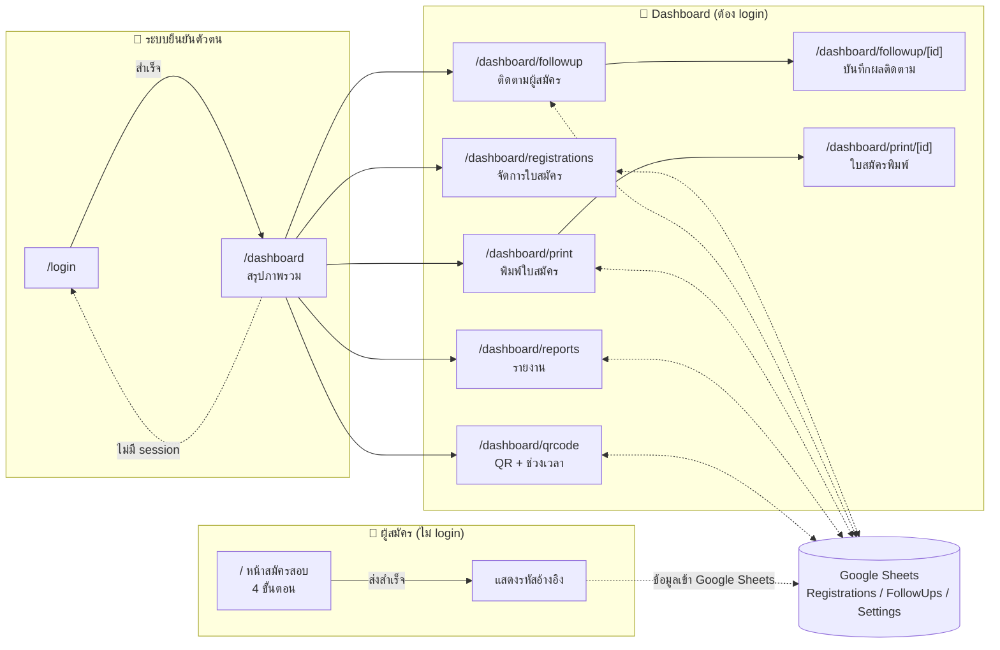

# SRD App — ภาพรวมระบบและ UX/UI Workflow

> เอกสารนี้วิเคราะห์จากซอร์สโค้ดจริงของโปรเจกต์ `srd-app` (Next.js 16 / React 19 / TypeScript)
> เพื่อสรุปโครงสร้างหน้าจอ เส้นทางผู้ใช้ (user flow) และกฎเชิง UX ที่ฝังอยู่ในโค้ด
> ใช้เป็นฐานสำหรับทีมออกแบบ/พัฒนาต่อ หรือ onboarding ทีมใหม่

## 1. ระบบนี้คืออะไร

**SRD App** เป็นระบบ **รับสมัครสอบธรรมศึกษา** ของ **สำนักเรียนวัดสารอด** (ภายใต้สำนักงานแม่กองธรรมสนามหลวง)
ประกอบด้วย 2 ฝั่งหลัก:

| ฝั่ง | ผู้ใช้ | หน้าที่ |
|---|---|---|
| **Public (หน้าบ้าน)** | ผู้สมัครสอบทั่วไป (ไม่ต้อง login) | กรอกใบสมัครสอบธรรมศึกษาแบบ multi-step form |
| **Dashboard (หลังบ้าน)** | เจ้าหน้าที่ 5 ระดับสิทธิ์ | อนุมัติ/ปฏิเสธใบสมัคร, ติดตามผู้สมัคร, ออกรายงาน, พิมพ์ใบสมัคร, สร้าง QR Code และกำหนดช่วงเวลารับสมัคร |

ข้อมูลทั้งหมดเก็บบน **Google Sheets** (ไม่มีฐานข้อมูลของตัวเอง) ผ่าน Google Sheets API (service account)
โดยมี 3 ชีตหลัก: `Registrations`, `FollowUps`, `Settings`

## 2. แผนผังเส้นทางทั้งระบบ (Sitemap)

```
/                               → หน้าสมัครสอบ (public, 4 steps)
/login                          → หน้าเข้าสู่ระบบเจ้าหน้าที่
/dashboard                      → แดชบอร์ดสรุปภาพรวม
/dashboard/registrations        → รายการใบสมัคร + อนุมัติ/ปฏิเสธ
/dashboard/followup             → รายการติดตามผู้สมัคร
/dashboard/followup/[id]        → หน้าบันทึกผลการติดตาม (รายบุคคล)
/dashboard/print                → รายการสำหรับเลือกพิมพ์
/dashboard/print/[id]           → ใบสมัครฉบับพิมพ์ (A4, สั่งพิมพ์/บันทึก PDF)
/dashboard/reports              → หน้ารายงานสถิติ
/dashboard/qrcode               → สร้าง QR Code + ตั้งค่าช่วงเวลารับสมัคร
```

ภาพรวมเป็น Mermaid diagram:



## 3. สถาปัตยกรรมเชิงเทคนิค (ที่กระทบ UX)

- **Next.js App Router** — ทุกหน้าใน `/dashboard/*` เป็น Server Component ที่ดึงข้อมูลจาก Google Sheets ตอน render (SSR, `dynamic = 'force-dynamic'`) แล้วส่งต่อให้ Client Component ที่เป็น interactive UI
- **ไม่มีฐานข้อมูลจริง** — Google Sheets ทำหน้าที่เป็น database ทำให้:
  - ทุกการอ่าน/เขียนข้อมูลมี latency สูงกว่าฐานข้อมูลปรกติ → ทุกหน้า dashboard มี timeout 10 วินาที พร้อมข้อความ error ภาษาไทยเฉพาะ
  - ไม่มี real-time update ข้ามผู้ใช้ (ต้อง refresh หน้าเพื่อเห็นข้อมูลล่าสุดจากคนอื่น)
- **Session/Auth** แบบ custom cookie (HMAC-signed token, ไม่ใช่ library มาตรฐาน) อายุ 24 ชม. เก็บ `srd-session` cookie แบบ httpOnly
- **Middleware (`proxy.ts`)** เช็คสิทธิ์เบื้องต้นระดับ route: `/dashboard/*` ต้องมี cookie, `/login` ถ้า login แล้วจะ redirect ออกไป `/dashboard`
- **Role-based UI** — เมนู sidebar และปุ่ม action จะถูกซ่อน/แสดงตามสิทธิ์ของผู้ใช้ (ดูเอกสาร `09-data-model-permissions.md`)

## 4. บัญชีผู้ใช้ (Hardcoded ในโค้ด)

| Username | Password | Role | หมายเหตุ |
|---|---|---|---|
| superadmin | super1234 | superadmin | สิทธิ์เต็ม |
| admin | admin1234 | admin | สิทธิ์เต็มเหมือน superadmin |
| teacher | teacher1234 | teacher | ดูรายงาน + ติดตามได้ แต่อนุมัติไม่ได้ |
| student | student1234 | student | พิมพ์ได้อย่างเดียว |
| guest | guest1234 | guest | ดูแดชบอร์ด/ใบสมัครได้ แต่พิมพ์ไม่ได้ |

> ⚠️ **พบปัญหาเชิงความปลอดภัย**: รหัสผ่านถูก hardcode เป็น plaintext ในซอร์สโค้ด (`src/lib/auth.ts`) ไม่มีการเก็บใน database หรือ hash — ควรปรับปรุงก่อนขึ้น production จริง

## 5. ดัชนีเอกสารที่เกี่ยวข้อง

| ไฟล์ | เนื้อหา |
|---|---|
| `01-public-registration.md` | Workflow หน้าสมัครสอบ (public form 4 steps) |
| `02-login.md` | Workflow หน้า login |
| `03-dashboard.md` | Workflow แดชบอร์ดสรุปภาพรวม + Shell/Navigation |
| `04-registrations.md` | Workflow จัดการใบสมัคร (อนุมัติ/ปฏิเสธ/ค้นหา/กรอง) |
| `05-followup.md` | Workflow ติดตามผู้สมัคร (list + detail) |
| `06-print.md` | Workflow พิมพ์ใบสมัคร |
| `07-qrcode-period.md` | Workflow สร้าง QR Code และตั้งค่าช่วงเวลารับสมัคร |
| `08-reports.md` | Workflow หน้ารายงานสถิติ |
| `09-data-model-permissions.md` | โมเดลข้อมูล, สถานะ, สิทธิ์การเข้าถึงแต่ละ role |

## 6. ข้อสังเกตเชิง UX ที่ควรปรับปรุง (Quick findings)

- ฟอร์มสมัคร (public) มี step validation ที่ดี แต่ **ไม่มีการบันทึก draft** — ถ้าปิดแท็บ/รีเฟรชระหว่างกรอก ข้อมูลหายทั้งหมด
- Dashboard ทุกหน้าโหลดข้อมูล "ทั้งหมด" จาก Google Sheets ทุกครั้งที่เข้าหน้า (`getAllRegistrations()`) ไม่มี pagination/caching — จะช้าลงเมื่อข้อมูลมาก
- การแจ้งผล action (อนุมัติ/ปฏิเสธ, บันทึกติดตาม) ใช้ toast/alert แบบ inline ไม่ auto-dismiss บางที่ (ต้องกดปิดเอง เช่นหน้า registrations)
- หน้า `print/[id]` และ `followup/[id]` ไม่มี loading skeleton ระหว่างรอข้อมูล (fetch แบบ blocking ที่ server)
- ไม่มีการแจ้งเตือนแบบ real-time เมื่อมีใบสมัครใหม่เข้ามา (ต้องกด refresh/เข้าหน้าใหม่)
