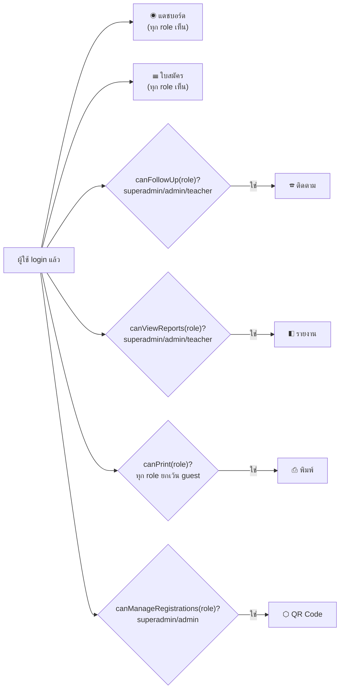
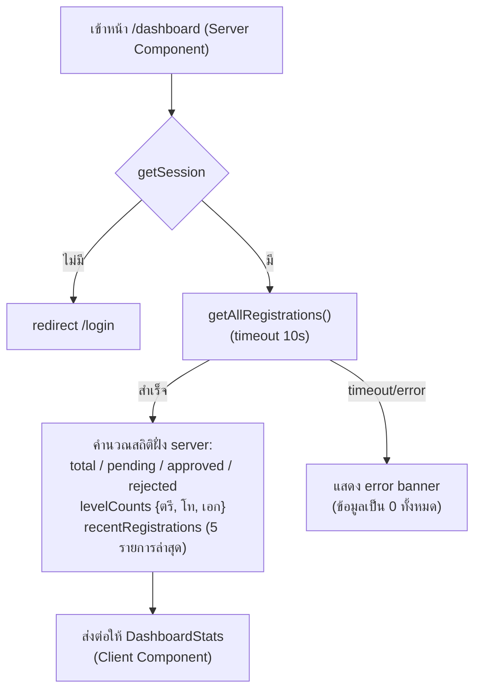

# Workflow: แดชบอร์ดหลัก + โครงสร้าง Navigation

**Route:** `/dashboard`
**ไฟล์หลัก:** `src/app/dashboard/layout.tsx`, `dashboard-shell.tsx`, `page.tsx`, `dashboard-stats.tsx`

## 1. โครงสร้าง Layout ทุกหน้าใน Dashboard

ทุกหน้าใต้ `/dashboard/*` ใช้ shell เดียวกัน (`DashboardShell`) เป็น 2 คอลัมน์:

```
┌──────────────┬──────────────────────────────────┐
│  SIDEBAR      │  MAIN CONTENT (children)          │
│ ┌──────────┐ │  ┌──────────────────────────────┐ │
│ │โลโก้ SRD App│ │  │ Page Header (h1 + คำอธิบาย)    │ │
│ │สำนักเรียนวัดสารอด│ │  │ [Error banner ถ้ามี]           │ │
│ └──────────┘ │  │ เนื้อหาเฉพาะหน้า...              │ │
│ ◉ แดชบอร์ด    │  └──────────────────────────────┘ │
│ ☰ ใบสมัคร     │                                    │
│ ☎ ติดตาม      │                                    │
│ ◧ รายงาน      │                                    │
│ ⎙ พิมพ์        │                                    │
│ ⬡ QR Code     │                                    │
│ ──────────── │                                    │
│ ชื่อผู้ใช้/role │                                    │
│ [ออกจากระบบ]  │                                    │
└──────────────┴──────────────────────────────────┘
```

## 2. เมนู Sidebar แบบ Role-based



เมนูที่ role ไม่มีสิทธิ์จะ **หายไปจาก sidebar เลย** (ไม่ใช่แค่ disable) — ลิงก์ที่ active จะถูก highlight ด้วยการเทียบ `pathname === item.href` แบบ exact match

## 3. หน้าแดชบอร์ด (Overview) — `/dashboard`



### องค์ประกอบหน้าจอ

1. **Stat cards (4 ใบ)**: ใบสมัครทั้งหมด / รอดำเนินการ / อนุมัติแล้ว / ไม่อนุมัติ — ตัวเลขใหญ่ + label
2. **การ์ด "สมัครแยกตามชั้น"**: bar chart แนวนอนแบบ custom (ไม่ใช้ library) แสดงสัดส่วนธรรมศึกษาชั้นตรี/โท/เอก เทียบกับยอดรวม (`width: (count/total)*100%`)
3. **การ์ด "ใบสมัครล่าสุด"**: ตาราง 5 แถวล่าสุด (ชื่อ-นามสกุล, ชั้น, สถานะ) + ลิงก์ "ดูทั้งหมด" ไปหน้า `/dashboard/registrations` — ถ้าไม่มีข้อมูลแสดง "ยังไม่มีใบสมัคร"

### Badge สถานะ (ใช้ร่วมกันหลายหน้า)

| สถานะ (DB) | Label ไทย | สี/class |
|---|---|---|
| `PENDING` | รอดำเนินการ | `badge-pending` (เหลือง) |
| `APPROVED` | อนุมัติ | `badge-approved` (เขียว) |
| `REJECTED` | ไม่อนุมัติ / ปฏิเสธ | `badge-rejected` (แดง) |

## 4. พฤติกรรม Loading / Error ร่วมของทุกหน้า Dashboard

ทุกหน้าที่ดึงข้อมูลจาก Google Sheets (`dashboard`, `registrations`, `reports`, `followup`, `print`) ใช้รูปแบบเดียวกัน:

```ts
Promise.race([
  getAllRegistrations(),
  timeout(10000) // 10 วินาที
])
```

- ถ้าเกิน 10 วิ → ข้อความ "การเชื่อมต่อ Google Sheets หมดเวลา กรุณาลองใหม่" (เฉพาะหน้า dashboard มีข้อความนี้แยก, หน้าอื่นใช้ข้อความทั่วไป "ไม่สามารถดึงข้อมูลจาก Google Sheets ได้")
- หน้าจะยัง**render ได้ปกติ**แต่ข้อมูลเป็น array ว่าง — ไม่ใช่หน้า error เต็มจอ (graceful degradation)
- ทุกหน้าใช้ `export const dynamic = 'force-dynamic'` → บังคับ fetch ใหม่ทุกครั้งที่เข้าหน้า ไม่มี caching ของ Next.js
