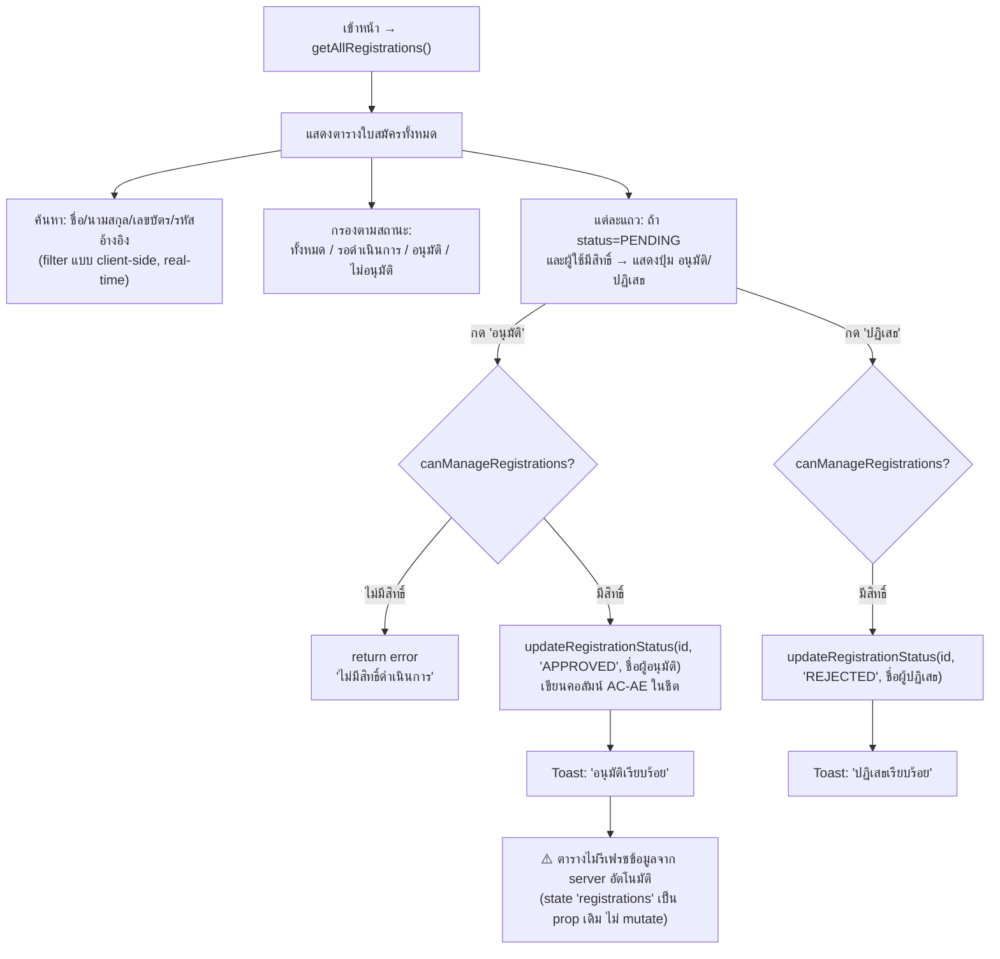

# Workflow: จัดการใบสมัคร (Registrations)

**Route:** `/dashboard/registrations`
**ไฟล์หลัก:** `page.tsx`, `registration-list.tsx`, `../actions.ts` (`approveRegistration`, `rejectRegistration`)
**สิทธิ์เข้าดู:** ทุก role ที่ login แล้ว | **สิทธิ์อนุมัติ/ปฏิเสธ:** เฉพาะ `superadmin`, `admin` (`canManageRegistrations`)

## 1. Flow การอนุมัติใบสมัคร



> **หมายเหตุสำคัญ (พฤติกรรมจริงจากโค้ด):** หลังกดอนุมัติ/ปฏิเสธสำเร็จ Component จะตั้งค่า `actionResult` (toast message) แต่ **ไม่ได้อัปเดต state `registrations` ที่ใช้ render ตาราง** และไม่มีการ `router.refresh()` — ปุ่ม "อนุมัติ/ปฏิเสธ" ของแถวนั้นจะยังค้างแสดงอยู่ (เพราะ `r.status` ใน local state ยังเป็น `PENDING`) จนกว่าผู้ใช้จะ reload หน้าเอง นี่คือจุดที่ UX ควรแก้ไข (เพิ่ม optimistic update หรือ router.refresh)

## 2. โครงหน้าจอ

```
┌─────────────────────────────────────────────┐
│ จัดการใบสมัคร                                   │
│ ดูรายการใบสมัครและจัดการสถานะ                     │
│ [error banner ถ้ามี]                            │
├─────────────────────────────────────────────┤
│ [🔍 ค้นหาชื่อ, นามสกุล, เลขบัตร, รหัสอ้างอิง...]      │
│ [ทั้งหมด] [รอดำเนินการ] [อนุมัติ] [ไม่อนุมัติ]  ← filter tabs │
├─────────────────────────────────────────────┤
│ [toast ผลลัพธ์ล่าสุด ถ้ามี — คลิกเพื่อปิด]             │
├─────────────────────────────────────────────┤
│ รหัสอ้างอิง│ชื่อ-สกุล│ชั้น│สำนักเรียน│วันที่│สถานะ│จัดการ │
│ REG-...   │ ...    │ตรี│...     │...  │[badge]│[อนุมัติ][ปฏิเสธ]│
│ ...แถวซ้ำ...                                      │
├─────────────────────────────────────────────┤
│ แสดง N จาก M รายการ                               │
└─────────────────────────────────────────────┘
```

## 3. รายละเอียด UI

- **ช่องค้นหา**: ค้นหาแบบ case-insensitive บนฟิลด์ `firstName`, `lastName`, `citizenId`, `registrationId` พร้อมกัน (ไม่ต้องเลือกว่าจะค้นฟิลด์ไหน) — ทำงานฝั่ง client (ข้อมูลทั้งหมดถูกโหลดมาแล้ว ไม่มี server-side search)
- **ปุ่มกรองสถานะ**: ปุ่ม toggle 4 ปุ่ม (ไม่ใช่ dropdown) active state เน้นด้วย class `.active`
- **รหัสอ้างอิง**: เป็นลิงก์คลิกไปหน้า **พิมพ์ใบสมัคร** ของรายการนั้นโดยตรง (`/dashboard/print/{id}`) — เป็น shortcut ที่ซ่อนอยู่ ไม่มี label บอกว่าคลิกแล้วจะไปพิมพ์
- **คอลัมน์ "จัดการ"** แสดงเฉพาะผู้ใช้ที่มีสิทธิ์ (`canManage`) และปุ่ม อนุมัติ/ปฏิเสธ แสดงเฉพาะแถวที่ `status === 'PENDING'` (แถวที่อนุมัติ/ปฏิเสธไปแล้วจะไม่มีปุ่มใดๆ ให้ "ย้อนสถานะ" กลับ)
- ระหว่างกำลังประมวลผล action (`isPending` จาก `useTransition`) ปุ่มทุกปุ่มในตาราง (ทุกแถว) จะถูก disable พร้อมกันทั้งตาราง ไม่ใช่แค่แถวที่กด
- แถวว่าง: ถ้า filter แล้วไม่พบข้อมูลเลย แสดงข้อความ "ไม่พบข้อมูล" กลางตาราง (colspan เต็มแถว)
- Footer ตารางสรุป "แสดง N จาก M รายการ" (N=หลัง filter, M=ทั้งหมด)

## 4. สิทธิ์การมองเห็น/การกระทำ

| Role | เห็นตาราง | เห็นคอลัมน์ "จัดการ" | กดอนุมัติ/ปฏิเสธได้ |
|---|---|---|---|
| superadmin / admin | ✅ | ✅ | ✅ |
| teacher / student / guest | ✅ | ❌ | ❌ (ฟังก์ชัน server จะ reject ด้วยถ้าพยายามเรียกตรง) |

การตรวจสอบสิทธิ์ทำทั้งฝั่ง **UI** (ซ่อนปุ่ม) และฝั่ง **server action** (`approveRegistration`/`rejectRegistration` เช็ค `canManageRegistrations` อีกรอบ) — ป้องกันการ bypass ผ่าน dev tools
