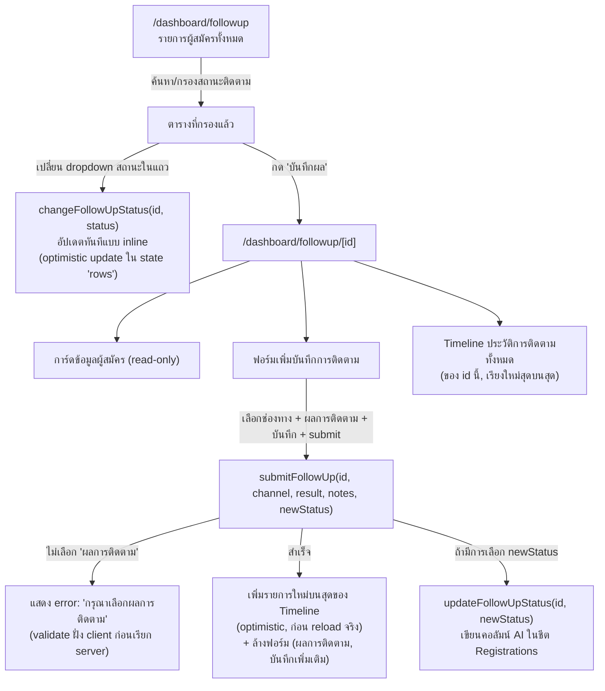

# Workflow: ติดตามผู้สมัคร (Follow-up)

**Routes:** `/dashboard/followup` (รายการ), `/dashboard/followup/[id]` (รายละเอียด+บันทึกผล)
**ไฟล์หลัก:** `followup-list.tsx`, `followup/[id]/followup-detail.tsx`, `../actions.ts`
**สิทธิ์:** `superadmin`, `admin`, `teacher` (`canFollowUp`) — role อื่นถูก redirect กลับ `/dashboard`

## 1. ภาพรวม Flow



## 2. หน้ารายการ (`/dashboard/followup`)

```
┌───────────────────────────────────────────────────────────┐
│ ติดตามผู้สมัคร                                                │
│ ติดตามผู้สมัครผ่านโทรศัพท์และไลน์ บันทึกผลการติดตาม             │
├───────────────────────────────────────────────────────────┤
│ [🔍 ค้นหา...]                                                │
│ [ทั้งหมด][ยังไม่ติดตาม][รอติดตาม][กำลังติดตาม][สำเร็จ][ยกเลิก] │
├───────────────────────────────────────────────────────────┤
│รหัสอ้างอิง│ชื่อ│ชั้น│สถานะใบสมัคร│สถานะติดตาม│เปลี่ยนสถานะ│ดำเนินการ│
│ REG-...  │... │ตรี│[badge]     │[badge]    │[select ▾] │[บันทึกผล]│
└───────────────────────────────────────────────────────────┘
```

### สถานะการติดตาม (Follow-up Status) — ค่าที่ใช้ได้

| ค่าในระบบ | Label ไทย | Badge class |
|---|---|---|
| `''` (ว่าง) | ยังไม่ติดตาม | `badge-none` |
| `FOLLOW_PENDING` | รอติดตาม | `badge-pending` |
| `FOLLOW_IN_PROGRESS` | กำลังติดตาม | `badge-followup-progress` |
| `FOLLOW_SUCCESS` | ติดตามสำเร็จ | `badge-approved` |
| `FOLLOW_CANCELLED` | ยกเลิก | `badge-rejected` |

**จุดเด่น UX:** dropdown "เปลี่ยนสถานะ" ในตารางรายการ ทำให้เปลี่ยนสถานะติดตามได้ทันทีโดย**ไม่ต้องเข้าหน้ารายละเอียด** — ใช้ optimistic update (เปลี่ยนที่ state ทันทีเมื่อ server ตอบสำเร็จ) ระหว่างอัปเดต dropdown จะ disable (`updating === registrationId`) เพื่อกันกดซ้ำ

## 3. หน้ารายละเอียด (`/dashboard/followup/[id]`)

```
┌─────────────────────────────┐  ┌─────────────────────────────┐
│ ข้อมูลผู้สมัคร (read-only)      │  │ เพิ่มบันทึกการติดตาม            │
│ รหัสอ้างอิง / ชื่อ-สกุล          │  │ ช่องทางติดตาม [📞 โทร][💬 LINE]│
│ ชั้นที่สมัคร / สถานะใบสมัคร       │  │ ผลการติดตาม [dropdown ▾]     │
│ เบอร์โทร / LINE ID            │  │ บันทึกเพิ่มเติม [textarea]      │
│ สถานะติดตาม / วันที่สมัคร       │  │ อัปเดทสถานะติดตาม [dropdown ▾] │
│ ← กลับไปรายการติดตาม           │  │ [บันทึกการติดตาม]              │
└─────────────────────────────┘  └─────────────────────────────┘
┌───────────────────────────────────────────────────────────┐
│ ประวัติการติดตาม (N ครั้ง)                                      │
│ 📞/💬  [ช่องทาง]                            [วันที่-เวลาไทย]      │
│       [ผลการติดตาม]                                           │
│       [บันทึกเพิ่มเติม ถ้ามี]                                     │
│       โดย: [ชื่อผู้ติดตาม]                                        │
│  ... (timeline เรียงจากใหม่ไปเก่า) ...                           │
└───────────────────────────────────────────────────────────┘
```

### ตัวเลือกในฟอร์มบันทึกการติดตาม

- **ช่องทางติดตาม**: ปุ่ม toggle 2 ปุ่ม 📞 โทรศัพท์ / 💬 ไลน์ (ไม่ใช่ dropdown) ค่าเริ่มต้น = โทรศัพท์
- **ผลการติดตาม** (บังคับเลือก): ติดต่อได้-ยืนยันเข้าเรียน / ติดต่อได้-ขอข้อมูลเพิ่มเติม / ติดต่อได้-ขอเลื่อน / ติดต่อได้-ยกเลิก / ไม่รับสาย / หมายเลขไม่ถูกต้อง / ไม่ตอบข้อความ / อื่นๆ
- **บันทึกเพิ่มเติม**: textarea อิสระ (optional) พร้อม placeholder แนะนำ เช่น นัดหมายวันที่, เบอร์ที่โทร
- **อัปเดทสถานะติดตาม**: dropdown ค่าเริ่มต้น = สถานะปัจจุบันของผู้สมัคร (หรือ `FOLLOW_IN_PROGRESS` ถ้ายังไม่มี) — เลือก "ไม่เปลี่ยนสถานะ" ได้เพื่อบันทึกแค่ log โดยไม่กระทบสถานะ

### Behaviour หลังบันทึกสำเร็จ

- ประวัติใหม่ถูก **เติมลงบนสุดของ Timeline ทันที** (optimistic, ยังไม่ได้ query ใหม่จาก Google Sheets — `followUpId: 'NEW'`, `followedBy: 'คุณ'`)
- ฟอร์มถูกล้างเฉพาะ "ผลการติดตาม" และ "บันทึกเพิ่มเติม" (ช่องทางและสถานะที่เลือกไว้ยังคงอยู่ เผื่อบันทึกต่อเนื่องหลายครั้งในช่องทางเดียวกัน)
- ข้อความแจ้งผล "บันทึกการติดตามสำเร็จ" ไม่ auto-dismiss (ค้างอยู่จนบันทึกครั้งถัดไป)

## 4. Edge cases ที่จัดการในโค้ด

- ถ้าหา registration ด้วย `id` ไม่พบ → หน้าแสดง error "ไม่พบข้อมูลผู้สมัครรหัส {id}" และไม่ render ฟอร์มใดๆ
- ถ้า Google Sheets timeout (>10s) → error "ไม่สามารถดึงข้อมูลจาก Google Sheets ได้"
- role ที่ไม่มีสิทธิ์ (`student`, `guest`) พยายามเข้า URL ตรงๆ → ถูก redirect กลับ `/dashboard` ทันทีที่ server-side (ไม่เห็นหน้าแม้แวบหนึ่ง)
