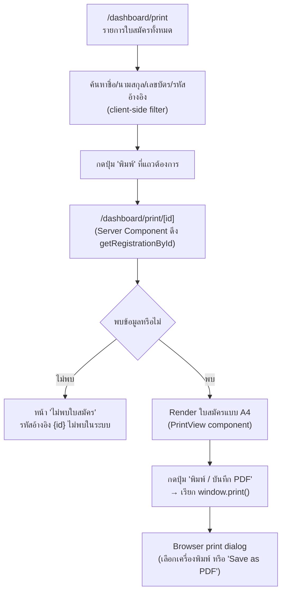

# Workflow: พิมพ์ใบสมัคร (Print)

**Routes:** `/dashboard/print` (รายการ), `/dashboard/print/[id]` (ใบสมัครพิมพ์)
**ไฟล์หลัก:** `print-list.tsx`, `print/[id]/print-view.tsx`
**สิทธิ์:** ทุก role ยกเว้น `guest` (`canPrint`)

## 1. Flow



## 2. โครงหน้าจอใบสมัคร (สำหรับพิมพ์)

```
┌──────────────────────────────────────────────┐
│ [ปุ่ม "พิมพ์ / บันทึก PDF"]   ← class "no-print" (ซ่อนตอนพิมพ์จริง) │
├──────────────────────────────────────────────┤
│ [โลโก้วัดสารอด]  ใบสมัครเรียน/สอบธรรมศึกษา  [โลโก้สำนัก] │
│                สำนักเรียนวัดสารอด                  │
│                สำนักงานแม่กองธรรมสนามหลวง          │
│ รหัสอ้างอิง: REG-...   ปีการศึกษา: 25XX           │
├──────────────────────────────────────────────┤
│ ข้อมูลผู้สมัคร: ชื่อ-สกุล, เลขบัตร, อายุ, วันเกิด, โทร, LINE │
│ ที่อยู่: บ้านเลขที่, หมู่ที่, ตำบล, อำเภอ, จังหวัด, ไปรษณีย์   │
│ ประวัติธรรมศึกษาเดิม: เลขทะเบียน, ชั้นเดิม, ช่วงชั้น, ปี, จังหวัด │
│ ชั้นที่สมัครสอบ: ชั้นธรรมศึกษา, ระดับ, สำนักเรียน, ที่อยู่สำนัก │
│ สถานะการสมัคร: สถานะ, ผู้อนุมัติ, วันที่อนุมัติ, วันที่สมัคร  │
├──────────────────────────────────────────────┤
│ [เส้นลงชื่อ]        [เส้นลงชื่อ]       [เส้นลงชื่อ]    [เส้นลงชื่อ]│
│ ผู้สมัคร            เลขานุการเจ้าสำนัก   อาจารย์ใหญ่    เจ้าสำนักเรียน│
│ (ชื่อผู้สมัคร)       (พระมหาวิทยา...)   (พระมหาพิทักษ์...)(พระครูสังฆกิจดิลก,ดร.)│
└──────────────────────────────────────────────┘
```

## 3. รายละเอียดสำคัญ

- ใช้ CSS class `no-print` บนปุ่ม/ส่วนหัวที่ไม่ต้องการให้ติดไปในกระดาษ (มาตรฐาน print stylesheet pattern — ซ่อนด้วย `@media print`)
- เอกสารพิมพ์มี **ลายเซ็น 4 ช่อง** ที่ hardcode ชื่อตำแหน่งทางศาสนาไว้ล่วงหน้า (เลขานุการเจ้าสำนัก, อาจารย์ใหญ่, เจ้าสำนักเรียน) — เฉพาะช่อง "ผู้สมัคร" ที่ดึงชื่อจริงจากข้อมูล
- ฟิลด์ที่ไม่มีค่า (`''` หรือ undefined) จะแสดงเป็น `-` เสมอ (ฟังก์ชัน `InfoRow`)
- วันที่อนุมัติ/วันที่สมัคร ถูก format เป็นรูปแบบไทย (`toLocaleDateString('th-TH')`) ยกเว้นกรณี `approvedDate === '-'` (ยังไม่อนุมัติ) จะคงค่า `-` ไว้ไม่แปลงวันที่
- **ไม่มี** ฟังก์ชัน export PDF โดยตรงในแอป — การ "บันทึกเป็น PDF" ต้องผ่าน dialog การพิมพ์ของเบราว์เซอร์เอง (`window.print()` แล้วเลือก destination เป็น "Save as PDF")
- หน้ารายการพิมพ์ (`print-list.tsx`) **ไม่มีตัวกรองตามสถานะ** (ต่างจากหน้า registrations/followup ที่มี filter ปุ่มสถานะ) มีแค่ช่องค้นหาอย่างเดียว

## 4. ความแตกต่างจากหน้า `registration-list`

| | `/dashboard/registrations` | `/dashboard/print` |
|---|---|---|
| ปุ่มอนุมัติ/ปฏิเสธ | ✅ (ตามสิทธิ์) | ❌ ไม่มี |
| Filter สถานะ | ✅ | ❌ ไม่มี |
| คอลัมน์สุดท้าย | "จัดการ" | "พิมพ์" (ลิงก์ไปหน้า print/[id] เสมอ ทุก role ที่เข้าถึงได้) |
