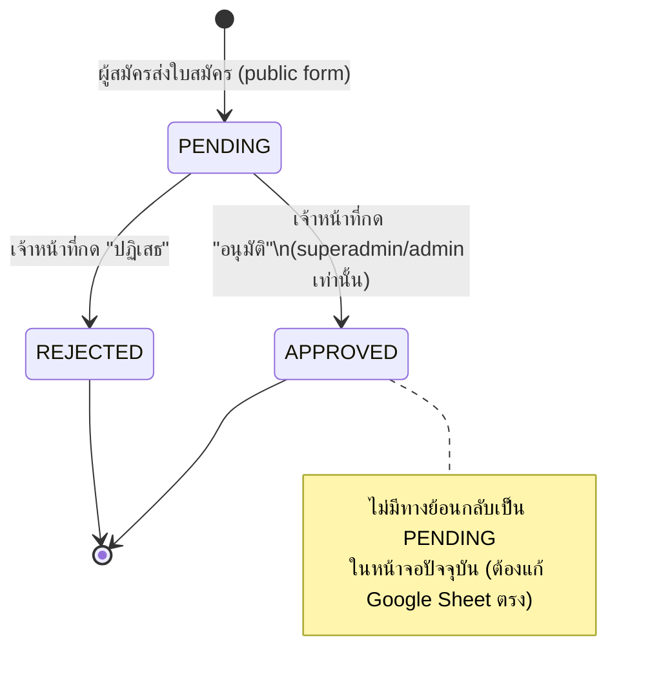
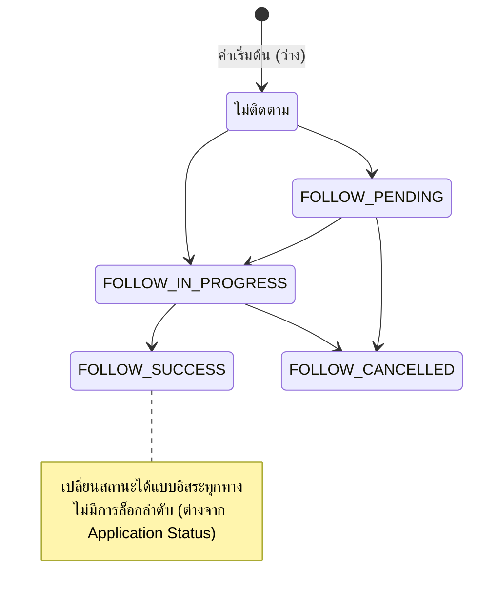

# โมเดลข้อมูลและสิทธิ์การเข้าถึง (Data Model & Permissions)

## 1. แหล่งข้อมูล: Google Sheets (3 ชีต)

### ชีต `Registrations` (37 คอลัมน์ A–AK)

| # | Column | Field (TS) | หมายเหตุ |
|---|---|---|---|
| A(0) | รหัสอ้างอิง | registrationId | `REG-YYYYMMDD-XXXXXXXX` สุ่มอัตโนมัติ |
| B(1) | ปีการศึกษา พ.ศ. | academicYear | |
| C(2) | คำนำหน้าชื่อ | title | |
| D(3) | ชื่อ | firstName | |
| E(4) | นามสกุล | lastName | |
| F(5) | อายุ (ปี) | age | |
| G(6) | เกิดวันที่ | dobDay | |
| H(7) | เกิดเดือน | dobMonth | ชื่อเดือนไทยเต็ม |
| I(8) | เกิด พ.ศ. | dobYearBE | |
| J(9) | เลขบัตรประชาชน | citizenId | เก็บเฉพาะตัวเลข 13 หลัก, ใช้กันสมัครซ้ำ |
| K(10) | บ้านเลขที่ | addressNo | |
| L(11) | หมู่ที่ | moo | default `-` |
| M(12) | ตำบล/แขวง | subdistrict | |
| N(13) | อำเภอ/เขต | district | |
| O(14) | จังหวัด | province | |
| P(15) | รหัสไปรษณีย์ | postalCode | |
| Q(16) | การศึกษาปัจจุบัน | educationLevel | |
| R(17) | เลขทะเบียนประกาศนียบัตรเดิม | prevCertNo | default `ไม่มี (สอบครั้งแรก)` |
| S(18) | ชั้นเดิมที่สอบได้ | prevLevel | default `-` |
| T(19) | ช่วงชั้นเดิม | prevRange | default `-` |
| U(20) | สอบได้เมื่อ พ.ศ. | prevPassedYearBE | default `-` |
| V(21) | จังหวัดที่สอบได้เดิม | prevProvince | default `-` |
| W(22) | ชั้นที่สมัครสอบ | targetLevel | ตรี/โท/เอก |
| X(23) | ระดับช่วงชั้นที่สมัคร | targetRange | ประถม/มัธยม/อุดมศึกษา |
| Y(24) | สำนักเรียน/สถานศึกษา | officeName | |
| Z(25) | ตำบลสำนักเรียน | officeSubdistrict | fallback = ตำบลผู้สมัคร |
| AA(26) | อำเภอสำนักเรียน | officeDistrict | fallback = อำเภอผู้สมัคร |
| AB(27) | จังหวัดสำนักเรียน | officeProvince | fallback = จังหวัดผู้สมัคร |
| AC(28) | สถานะการสมัคร | status | `PENDING` / `APPROVED` / `REJECTED` |
| AD(29) | ผู้รับสมัคร/อนุมัติ | approvedBy | default `-` |
| AE(30) | วันที่อนุมัติ | approvedDate | ISO datetime, default `-` |
| AF(31) | วันที่ยื่นสมัคร | submittedDate | ISO datetime ตอนสร้างแถว |
| AG(32) | รหัสไปรษณีย์สำนักเรียน | officePostalCode | fallback = รหัสผู้สมัคร |
| AH(33) | ช่องทางที่ได้รู้จัก | referralSources | string คั่น `, ` อาจมีหลายค่า |
| AI(34) | สถานะการติดตาม | followUpStatus | ว่าง/FOLLOW_PENDING/IN_PROGRESS/SUCCESS/CANCELLED |
| AJ(35) | เบอร์โทรศัพท์ | phone | เก็บเฉพาะตัวเลข |
| AK(36) | ไอดีไลน์ | lineId | default `-` |

> ชีต `Registrations` และ header ถูกสร้าง **อัตโนมัติ** โดยโค้ด (`ensureRegistrationSheet`) ในการเรียกครั้งแรก ถ้ายังไม่มีชีตหรือคอลัมน์ไม่พอ — ไม่ต้องมีคนไปสร้างชีต/หัวตารางเองล่วงหน้า

### ชีต `FollowUps` (7 คอลัมน์ A–G)

| # | Column | Field |
|---|---|---|
| A | รหัสติดตาม | followUpId (`FU-YYYYMMDD-XXXXXX`) |
| B | รหัสอ้างอิงใบสมัคร | registrationId |
| C | วันที่ติดตาม | date (ISO) |
| D | ช่องทาง | channel (โทรศัพท์/ไลน์) |
| E | ผลการติดตาม | result |
| F | บันทึกเพิ่มเติม | notes |
| G | ผู้ติดตาม | followedBy (ชื่อ display ของผู้ login) |

### ชีต `Settings` (key-value, A–B)

| key | value | ใช้ที่ |
|---|---|---|
| `registration_start` | ISO datetime | หน้า public + QR settings |
| `registration_end` | ISO datetime | หน้า public + QR settings |
| `registration_mode` | `auto` / `force_open` / `force_closed` | ควบคุมว่าจะใช้ start/end หรือไม่ |

## 2. สถานะใบสมัคร (Application Status) — State Machine

## 3. สถานะการติดตาม (Follow-up Status) — อิสระจากสถานะใบสมัคร

## 4. ตาราง Role × Permission (สรุปรวมทั้งระบบ)

| Permission (ฟังก์ชันใน `auth-shared.ts`) | superadmin | admin | teacher | student | guest |
|---|---|---|---|---|---|
| Login เข้าระบบ | ✅ | ✅ | ✅ | ✅ | ✅ |
| ดูแดชบอร์ด + ดูรายการใบสมัคร | ✅ | ✅ | ✅ | ✅ | ✅ |
| `canManageRegistrations` (อนุมัติ/ปฏิเสธ, ตั้งค่า QR/ช่วงเวลา) | ✅ | ✅ | ❌ | ❌ | ❌ |
| `canViewReports` (หน้ารายงาน) | ✅ | ✅ | ✅ | ❌ | ❌ |
| `canFollowUp` (ติดตามผู้สมัคร) | ✅ | ✅ | ✅ | ❌ | ❌ |
| `canPrint` (พิมพ์ใบสมัคร) | ✅ | ✅ | ✅ | ✅ | ❌ |

**สังเกต:** `teacher` เกือบเท่า `admin` ยกเว้นอนุมัติ/ปฏิเสธใบสมัครและตั้งค่า QR ไม่ได้ · `student` ทำได้แค่ดู+พิมพ์ · `guest` ดูได้อย่างเดียว (ต่ำสุด)

## 5. การตรวจสอบสิทธิ์ (Defense in depth)

ทุก permission ถูกเช็ค **2 ชั้น** เสมอในโค้ดจริง:
1. **UI layer** — ซ่อนปุ่ม/เมนู/คอลัมน์ที่ role ไม่มีสิทธิ์ (sidebar filter, conditional render)
2. **Server Action layer** — ทุกฟังก์ชันใน `dashboard/actions.ts` (เช่น `approveRegistration`, `submitFollowUp`, `updateRegistrationPeriod`) เช็ค `getSession()` + permission function อีกครั้งก่อนเขียนข้อมูลจริง แม้ UI จะถูก bypass ก็ไม่สามารถเรียก action สำเร็จได้

สำหรับหน้าทั้งหน้า (ไม่ใช่แค่ action) เช่น `/dashboard/reports`, `/dashboard/followup`, `/dashboard/print`, `/dashboard/qrcode` — ถ้า role ไม่มีสิทธิ์จะถูก `redirect('/dashboard')` ตั้งแต่ server-side ก่อน render เนื้อหาใดๆ (ป้องกัน flash of unauthorized content)
