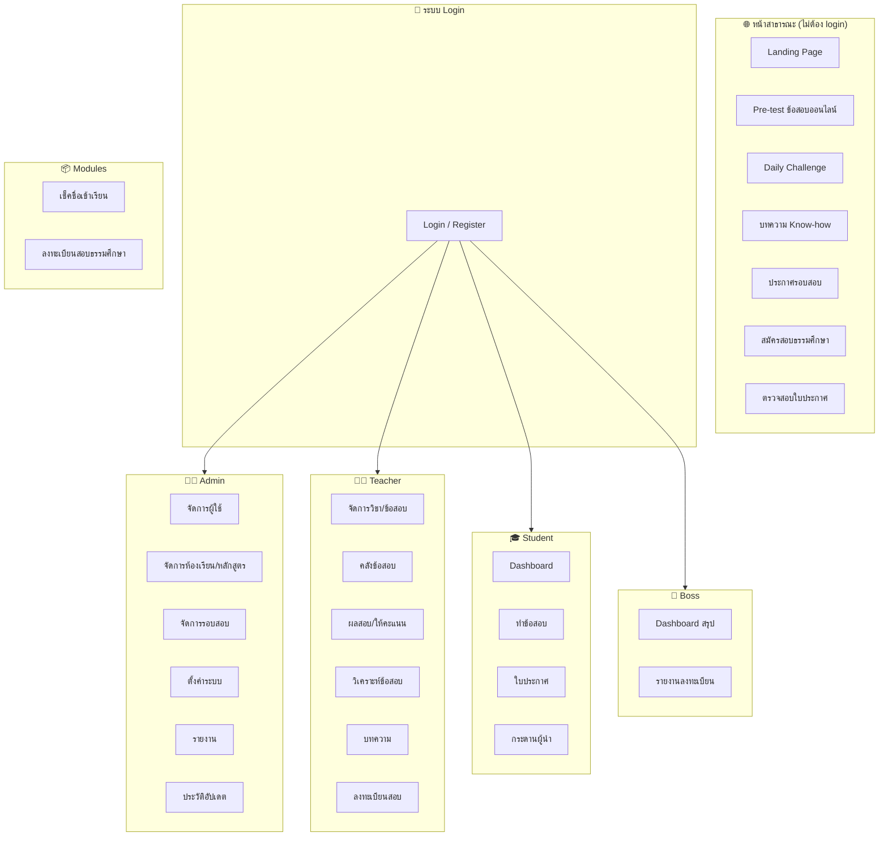

# 📋 สรุปโครงสร้างโปรเจกต์ quiz.budhipanna

> สรุปจากการสำรวจซอร์สโค้ดจริง — 10 ตุลาคม 2569

---

## 1. ภาพรวมระบบ

**quiz.budhipanna** คือระบบ **ข้อสอบออนไลน์ & สมัครสอบธรรมศึกษา** ของ **สำนักเรียนวัดสารอด** พัฒนาด้วย **Laravel 5.8** (PHP ≥ 7.3) รันบน Laragon (Windows)

| รายการ | รายละเอียด |
|---|---|
| Framework | Laravel 5.8.* |
| PHP | ≥ 7.3 |
| Database | MySQL (`budhipan_quiz`) |
| Frontend | Blade + Vanilla JS + Laravel Mix (Webpack) |
| Auth | Laravel built-in (multi-role) |
| Hosting | Shared hosting (public_html → myapp/public) |

---

## 2. โครงสร้างโฟลเดอร์หลัก

```
quiz.budhipanna/
├── docs/                           ← เอกสารประกอบโปรเจกต์
│   ├── laravel-module/             ← สเปค module ลงทะเบียนสอบ (42 KB)
│   └── ux-ui/                      ← เอกสาร UX/UI 10 ไฟล์ (จาก Next.js ต้นทาง)
│       ├── 00-overview.md
│       ├── 01-public-registration.md
│       ├── 02-login.md
│       ├── 03-dashboard.md
│       ├── 04-registrations.md
│       ├── 05-followup.md
│       ├── 06-print.md
│       ├── 07-qrcode-period.md
│       ├── 08-reports.md
│       └── 09-data-model-permissions.md
│
├── public_html/                    ← Document root ของ shared hosting
│   ├── .htaccess
│   ├── index.html                  ← หน้าแรก (redirect ไป /public)
│   └── public/                     ← Symlink/copy จาก myapp/public
│
└── myapp/                          ← ★ Laravel Application หลัก
    ├── app/
    ├── bootstrap/
    ├── config/
    ├── database/
    ├── docs/
    ├── public/
    ├── resources/
    ├── routes/
    ├── storage/
    ├── tests/
    ├── vendor/
    ├── composer.json
    ├── package.json
    └── webpack.mix.js
```

---

## 3. บทบาทผู้ใช้ (Roles)

ระบบแบ่งผู้ใช้เป็น **5 บทบาท** แต่ละบทบาทมี layout และ sidebar แยก:

| Role | Layout | สิทธิ์หลัก |
|---|---|---|
| **Admin** | `layouts/admin.blade.php` | จัดการทุกอย่าง: ผู้ใช้, หลักสูตร, ห้องเรียน, รอบสอบ, ตั้งค่า, รายงาน |
| **Teacher** | `layouts/teacher.blade.php` | สร้างข้อสอบ, จัดการคลังข้อสอบ, วิเคราะห์ผล, ดูรายงาน, จัดการลงทะเบียนสอบ, บทความ |
| **Student** | `layouts/student.blade.php` | ทำข้อสอบ, ดูผลสอบ, ใบประกาศนียบัตร, กระดานผู้นำ |
| **Boss** | `layouts/boss.blade.php` | Dashboard สรุปภาพรวม, ดูรายงานลงทะเบียนสอบ |
| **Guest** | ไม่ต้อง login | ทำ Pre-test, สมัครสอบ, Daily Challenge, อ่านบทความ |

---

## 4. Models (20 ไฟล์)

| Model | ตาราง/หน้าที่ |
|---|---|
| `User` | ผู้ใช้ (multi-role: admin, teacher, student, boss) |
| `Subject` | วิชา/หมวดวิชา |
| `Course` | หลักสูตร |
| `Classroom` | ห้องเรียน |
| `ExamSet` | ชุดข้อสอบ (public/private, กำหนดเวลา, คะแนนผ่าน) |
| `Question` | คำถาม (หลายประเภท) |
| `ExamAttempt` | การทำข้อสอบแต่ละครั้ง |
| `StudentAnswer` | คำตอบของนักเรียน (รวมการให้คะแนนข้อเรียงความ) |
| `StudentPassedExam` | บันทึกการสอบผ่าน |
| `Certificate` | ใบประกาศนียบัตร |
| `Article` | บทความ/Know-how (รองรับ media) |
| `DailyAttempt` | การเล่น Daily Challenge |
| `ExamSession` | รอบสอบธรรมศึกษา |
| `ExamCenter` | ศูนย์สอบ |
| `ExamRegistration` | ใบสมัครสอบธรรมศึกษา |
| `EssayCriterion` | เกณฑ์ให้คะแนนข้อเรียงความ |
| `EssayCriterionScore` | คะแนนรายเกณฑ์ |
| `Setting` | ตั้งค่าระบบ (key/value) |
| `SystemUpdate` | บันทึกอัปเดตระบบ |
| `VisitorLog` | บันทึกผู้เข้าชม |

---

## 5. Controllers

### 5.1 Controllers หลัก (ไม่ต้อง login)

| Controller | หน้าที่ |
|---|---|
| `PreTestController` | ระบบทำ Pre-test สาธารณะ (เลือกชุด, ทำข้อสอบ, ดูผล, สถิติ, คู่มือ) |
| `DailyChallengeController` | Daily Challenge (ตอบคำถามรายวัน, streak) |
| `KnowHowController` | บทความความรู้ |
| `ExamAnnouncementController` | ประกาศรอบสอบธรรมศึกษา |
| `PublicExamRegistrationController` | ฟอร์มสมัครสอบธรรมศึกษา 4 ขั้นตอน |
| `ProfileController` | หน้าโปรไฟล์ |

### 5.2 Admin Controllers

| Controller | หน้าที่ |
|---|---|
| `UserController` | CRUD ผู้ใช้ |
| `ClassroomController` | CRUD ห้องเรียน |
| `CourseController` | CRUD หลักสูตร |
| `ExamSessionController` | จัดการรอบสอบ + Export (Excel/PDF) |
| `SettingController` | ตั้งค่าระบบ (auto-generated form) |
| `ReportController` | รายงานสรุป |
| `SystemUpdateController` | ประวัติอัปเดตระบบ |

### 5.3 Teacher Controllers

| Controller | หน้าที่ |
|---|---|
| `SubjectController` | จัดการวิชา |
| `ExamSetController` | สร้าง/แก้ไขชุดข้อสอบ |
| `QuestionController` | จัดการคำถามรายชุด |
| `QuestionBankController` | คลังข้อสอบ (18 KB — ใหญ่ที่สุด) |
| `StudentResultController` | ดูผลสอบนักเรียน + ให้คะแนนเรียงความ |
| `AnalyticsController` | วิเคราะห์ข้อสอบ (สถิติ, กราฟ) |
| `ArticleController` | จัดการบทความ |
| `ExamRegistrationController` | จัดการใบสมัครสอบ |
| `ExamFollowUpController` | ติดตามผู้สมัคร |
| `ExamPeriodSettingsController` | ตั้งค่าช่วงเวลารับสมัคร |
| `ExamPrintController` | พิมพ์ใบสมัคร |
| `ExamReportController` | รายงานการสมัครสอบ |
| `EssayCriteriaController` | เกณฑ์ให้คะแนนเรียงความ |

### 5.4 Student Controllers

| Controller | หน้าที่ |
|---|---|
| `DashboardController` | หน้าแรกนักเรียน |
| `ExamController` | เลือกข้อสอบ + ทำข้อสอบ |
| `CertificateController` | ดู/ตรวจสอบใบประกาศ |
| `LeaderboardController` | กระดานผู้นำ |

### 5.5 Boss Controllers

| Controller | หน้าที่ |
|---|---|
| `BossDashboardController` | Dashboard สรุปภาพรวม |
| `ExamRegistrationController` | ดูรายงานลงทะเบียน |

### 5.6 Auth Controllers

| Controller | หน้าที่ |
|---|---|
| `LoginController` | เข้าสู่ระบบ |
| `RegisterController` | สมัครสมาชิก |
| `ForgotPasswordController` | ลืมรหัสผ่าน |
| `ResetPasswordController` | รีเซ็ตรหัสผ่าน |
| `VerificationController` | ยืนยันอีเมล |

---

## 6. Middleware

| Middleware | หน้าที่ |
|---|---|
| `RoleMiddleware` | ตรวจสอบบทบาทผู้ใช้ (role-based access) |
| `EnsureModuleEnabled` | ตรวจสอบว่าโมดูลเปิดใช้งานอยู่ |
| `TrackVisitor` | บันทึก visitor log |
| `Authenticate` | ตรวจสอบ login |
| `RedirectIfAuthenticated` | redirect ถ้า login แล้ว |

---

## 7. ระบบโมดูล (app/Modules)

ระบบรองรับ **modular architecture** — แต่ละโมดูลมี ServiceProvider, routes, controllers, models, views, migrations ของตัวเอง ลงทะเบียนผ่าน `config/modules.php`

### 7.1 Attendance Module (เช็คชื่อเข้าเรียน)

```
app/Modules/Attendance/
├── AttendanceServiceProvider.php
├── routes.php
├── Http/Controllers/
├── Models/
├── Support/
├── Views/
└── Database/Migrations/
```
ตาราง: `attendance_sessions`, `attendance_records`

### 7.2 ExamRegistration Module (ลงทะเบียนสอบธรรมศึกษา)

```
app/Modules/ExamRegistration/
├── ExamRegistrationServiceProvider.php
├── routes.php
├── Http/Controllers/
├── Models/
└── Views/
```
ตาราง: `exam_sessions`, `exam_centers`, `exam_registrations`

---

## 8. Views (Blade Templates)

### 8.1 Layouts (5 layouts ตาม role)

| Layout | ใช้กับ |
|---|---|
| `layouts/app.blade.php` | Layout หลัก (guest/public) |
| `layouts/admin.blade.php` | หน้า Admin |
| `layouts/teacher.blade.php` | หน้า Teacher |
| `layouts/student.blade.php` | หน้า Student |
| `layouts/boss.blade.php` | หน้า Boss |

### 8.2 Views ตามส่วนงาน

| โฟลเดอร์ | จำนวน | เนื้อหา |
|---|---|---|
| `views/pretest/` | 6 ไฟล์ | หน้า pre-test: index, show, take, result, stats, guide |
| `views/daily/` | 3 ไฟล์ | Daily Challenge: index, play, result |
| `views/knowhow/` | 4 ไฟล์ | บทความ: index, show + navbar, footer |
| `views/certificates/` | 1 ไฟล์ | ตรวจสอบใบประกาศ |
| `views/exam_announcements/` | 1 ไฟล์ | ประกาศรอบสอบ |
| `views/admin/` | 7 โฟลเดอร์ | classrooms, courses, exam_sessions, reports, settings, updates, users + dashboard |
| `views/teacher/` | 9 โฟลเดอร์ | analytics, articles, essay_criteria, exam_registration, exam_sets, question_bank, questions, results, subjects |
| `views/student/` | 3 โฟลเดอร์ | certificates, exams, leaderboard + dashboard |
| `views/boss/` | 1 โฟลเดอร์ | registrations + dashboard |
| `views/landing.blade.php` | 1 ไฟล์ | หน้าแรก Landing page (58 KB) |
| `views/public_exam_registration.blade.php` | 1 ไฟล์ | ฟอร์มสมัครสอบสาธารณะ (104 KB — Desktop) |
| `views/public_exam_registration_mobile.blade.php` | 1 ไฟล์ | ฟอร์มสมัครสอบสาธารณะ (91 KB — Mobile) |

---

## 9. Database

### 9.1 SQL Dump

- [`budhipan_quiz.sql`](file:///c:/laragon/www/quiz.budhipanna/myapp/database/budhipan_quiz.sql) — 2.8 MB

### 9.2 Migrations (22 ไฟล์)

| กลุ่ม | Migrations |
|---|---|
| **ระบบหลัก** | users, password_resets |
| **ข้อสอบ** | is_public (exam_sets), grading columns (student_answers), nullable user_id (exam_attempts) |
| **ผู้เยี่ยมชม** | visitor_logs |
| **Guest / บทความ** | guest_name (exam_attempts, certificates), articles, media fields |
| **Daily Challenge** | daily_attempts, daily_streak (users), system_updates |
| **NotebookLM** | notebooklm_url (articles) |
| **ตั้งค่า** | settings (key/value) |
| **ลงทะเบียนสอบ** | exam_registration_tables, remove_student_account, previous_certificate_no, public_details, notebooklm_url (exam_sessions), public_registration_fields, srd_exam_registration_tables, follow_up_fields |

---

## 10. Support / Infrastructure

### 10.1 Settings System

- ตาราง `settings` (key / value)
- อ่านผ่าน `App\Support\Settings\Settings::get('group.key', default)`
- Auto-generated admin UI — แต่ละโมดูลลงทะเบียนฟิลด์ผ่าน `SettingsRegistry`
- ชนิดฟิลด์: `text`, `textarea`, `number`, `boolean`, `select`, `time`

### 10.2 Module Registry

- `App\Support\Modules\ModuleRegistry` — ลงทะเบียนโมดูล + เมนู sidebar
- 3 พื้นที่เมนู: `teacher`, `admin`, `student`
- เมนูซ่อนอัตโนมัติเมื่อปิดโมดูล

---

## 11. เอกสารประกอบ

### 11.1 UX/UI Specs (จาก Next.js ต้นทาง → ใช้เป็น reference)

| ไฟล์ | เนื้อหา |
|---|---|
| [`00-overview.md`](file:///c:/laragon/www/quiz.budhipanna/docs/ux-ui/00-overview.md) | ภาพรวมระบบ, sitemap, สถาปัตยกรรม |
| [`01-public-registration.md`](file:///c:/laragon/www/quiz.budhipanna/docs/ux-ui/01-public-registration.md) | ฟอร์มสมัครสอบ 4 ขั้นตอน |
| [`02-login.md`](file:///c:/laragon/www/quiz.budhipanna/docs/ux-ui/02-login.md) | หน้า login |
| [`03-dashboard.md`](file:///c:/laragon/www/quiz.budhipanna/docs/ux-ui/03-dashboard.md) | Dashboard สรุปภาพรวม |
| [`04-registrations.md`](file:///c:/laragon/www/quiz.budhipanna/docs/ux-ui/04-registrations.md) | จัดการใบสมัคร |
| [`05-followup.md`](file:///c:/laragon/www/quiz.budhipanna/docs/ux-ui/05-followup.md) | ติดตามผู้สมัคร |
| [`06-print.md`](file:///c:/laragon/www/quiz.budhipanna/docs/ux-ui/06-print.md) | พิมพ์ใบสมัคร |
| [`07-qrcode-period.md`](file:///c:/laragon/www/quiz.budhipanna/docs/ux-ui/07-qrcode-period.md) | QR Code + ช่วงเวลารับสมัคร |
| [`08-reports.md`](file:///c:/laragon/www/quiz.budhipanna/docs/ux-ui/08-reports.md) | รายงานสถิติ |
| [`09-data-model-permissions.md`](file:///c:/laragon/www/quiz.budhipanna/docs/ux-ui/09-data-model-permissions.md) | โมเดลข้อมูล + สิทธิ์ |

### 11.2 สรุปงานก่อนหน้า

- [`summary-2026-10-07.md`](file:///c:/laragon/www/quiz.budhipanna/myapp/docs/summary-2026-10-07.md) — สรุปงานวันที่ 7 ต.ค. 69 (ฟอร์มสมัครสอบสาธารณะ)

---

## 12. ฟีเจอร์หลักของระบบ



---

## 13. Dependencies

### PHP (composer.json)

| Package | Version |
|---|---|
| `laravel/framework` | 5.8.* |
| `laravel/tinker` | ^1.0 |
| `fideloper/proxy` | ^4.0 |
| `phpunit/phpunit` (dev) | ^7.5 |
| `fzaninotto/faker` (dev) | ^1.4 |

### JS (package.json)

ใช้ Laravel Mix (Webpack) สำหรับ compile assets (JS + SASS)

---

## 14. Environment

| Key | ค่าตัวอย่าง |
|---|---|
| `DB_CONNECTION` | mysql |
| `DB_DATABASE` | budhipan_quiz (จาก .env) |
| `CACHE_DRIVER` | file |
| `SESSION_DRIVER` | file |
| `QUEUE_CONNECTION` | sync |

---

## 15. สถานะโปรเจกต์ & สิ่งที่ยังค้างอยู่

> จากเอกสาร summary-2026-10-07.md

- [ ] ขยายข้อมูลที่อยู่ไทย (`thai-addresses.json`) จาก ~100 records เป็น ~1,800 records ครบทุกตำบล
- [ ] ตรวจสอบข้อมูลทดสอบใน phpMyAdmin ว่าบันทึกครบทุกฟิลด์
- [ ] ทดสอบ Export Excel และ PDF บน production

---

> **หมายเหตุ**: เอกสาร UX/UI (docs/ux-ui/) เขียนจาก Next.js ต้นทาง — ระบบจริงถูกแปลงมาเป็น Laravel 5.8 + Blade + Vanilla JS แล้ว บางส่วน (เช่น Google Sheets เป็น backend) ถูกแทนที่ด้วย MySQL
